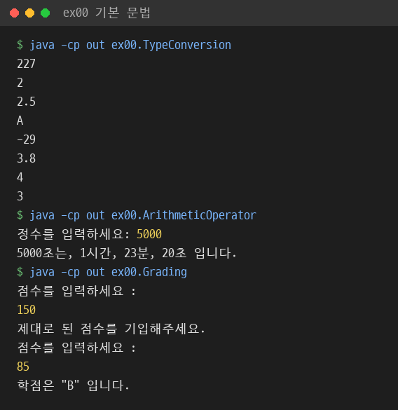
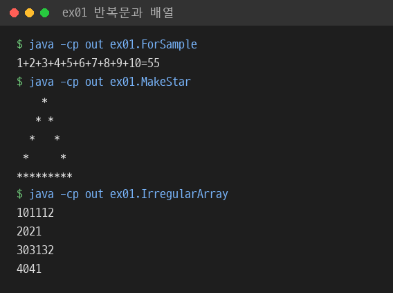
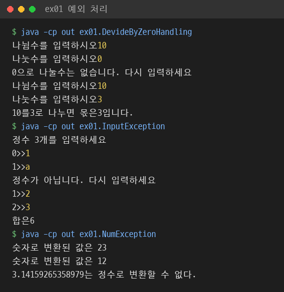
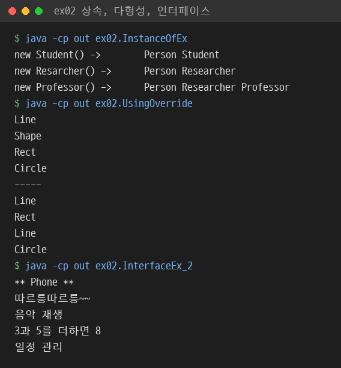
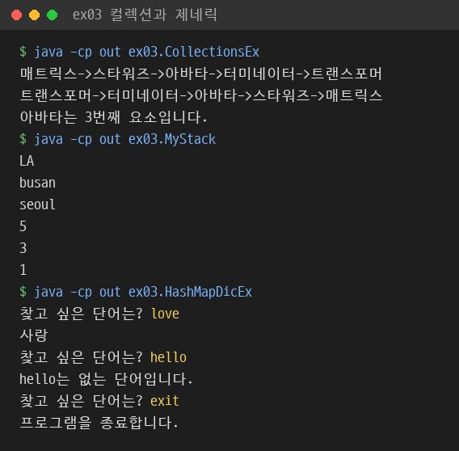

# Java 수업 실습

서지섭의 Java 수업 실습 저장소. 콘솔 프로그램으로 기본 문법과 객체지향을 익힌 뒤, 서블릿과 JSP, Spring MVC와 MyBatis로 회원 관리 웹 애플리케이션을 단계별로 구현한 기록.

- 언어: Java 11, pro26과 pro27은 Eclipse 설정상 Java 1.8
- 개발 도구: Eclipse
- 웹 실습: `javax.servlet` 기반 서블릿·JSP, Spring 3.0.6, MyBatis 3.0.5, Apache Tiles 2.2.2
- 데이터베이스: Oracle, `t_member` 회원 테이블

## 폴더 구성

| 폴더 | 주제 | 파일 수 | 주요 실습 |
|---|---|---|---|
| `ex00/src/ex00` | 변수, 연산자, 조건문, 입력 | 21 | 형 변환, 비트·논리 연산, if·switch 학점 계산, Scanner 입력 |
| `ex00/src/ex01` | 반복문, 배열, 예외, 클래스 기초 | 31 | for·while·do-while, 2차원 비정방 배열, try-catch, 생성자와 this, static 멤버 |
| `ex00/src/ex02` | 상속, 다형성, 인터페이스, 주요 클래스 | 20 | 메소드 오버라이딩, 추상 클래스, 인터페이스 다중 구현, Object·String·Wrapper 클래스 |
| `ex00/src/ex03` | 컬렉션, 제네릭 | 11 | Vector, ArrayList, LinkedList, HashMap, Iterator, 제네릭 스택 |
| `ex00/src/ex04` | 파일 입출력 | 7 | FileReader·FileWriter, 바이트 스트림, 버퍼 스트림, File 클래스 |
| `basics` | 기본 문법 | 21 | `ex00/src/ex00`과 같은 파일 구성, 4개 파일만 내용 차이 |
| `ex01` | 빈 Eclipse 프로젝트 | 1 | `module-info.java`만 존재 |
| `pro05`, `pro06` | 서블릿 기초 | 2, 10 | 서블릿 생명주기, GET·POST 요청 처리, 폼 데이터 수신, 환율 계산기, 구구단 |
| `pro07` | 서블릿과 DB 연동 | 9 | JDBC 직접 연결, JNDI 커넥션 풀, 회원 조회·등록·삭제 |
| `pro08` | 페이지 이동 | 18 | sendRedirect, Refresh, location, RequestDispatcher forward, request 속성 전달 |
| `pro09` | 쿠키와 세션 | 10 | Cookie 저장·조회, HttpSession, 세션 유효 시간, encodeURL, DB 기반 로그인 |
| `pro10` | 서블릿 고급 기능 | 9 | ServletContext·session·request 속성 범위, URL 매핑 방식, 필터, 세션 바인딩 리스너 |
| `pro14` | JSP 표현 언어 | 1 | EL 연산, param 객체, useBean·setProperty, jsp:forward |
| `pro17` | MVC 패턴 | 7 | 컨트롤러 서블릿, `*.do` 요청 분기, JSTL 목록 화면, 회원 수정·삭제 |
| `pro21` | Spring MVC 기초 | 2 | DispatcherServlet, SimpleUrlHandlerMapping, MultiActionController, ViewResolver |
| `pro22` | Spring JDBC | 7 | Controller·Service·DAO 계층 분리, setter 주입, JdbcTemplate |
| `pro23` | MyBatis 단독 사용 | 9 | SqlMapConfig, 매퍼 XML, resultMap, 조회·삽입·수정·삭제 |
| `pro24` | Spring과 MyBatis 연동 | 7 | SqlSessionFactoryBean, SqlSessionTemplate, 매퍼 위치 설정 |
| `pro26` | 애너테이션 기반 Spring MVC | 9 | @Controller, @RequestMapping, @RequestParam, @ModelAttribute, @Autowired, @Transactional |
| `pro27` | Tiles 레이아웃 | 7 | 공통 헤더·사이드·푸터 레이아웃, 로그인·로그아웃 세션 처리 |

파일 수는 `.java` 기준.

## 콘솔 실습 내용

### ex00 기본 문법

- 연산자: 초 단위 시간을 시·분·초로 변환하는 나머지 연산, 전위·후위 증감 연산 비교, `&` `|` `^` `~` 비트 연산과 시프트 연산
- 형 변환: `byte` 오버플로, 정수 나눗셈과 실수 나눗셈 차이, 강제 형 변환 위치에 따른 결과 차이
- 조건문: if-else 다중 분기와 switch 문으로 같은 학점 계산을 각각 구현, 중첩 if로 학년별 합격 기준 분리
- 입력 검증: 범위를 벗어난 점수 입력 시 `continue`로 재입력 요청
- 도형 판별: 점과 원의 거리 비교, 사각형 영역 판별, 세 변의 길이로 삼각형 성립 여부 판별

### ex01 반복문, 배열, 예외, 클래스 기초

- 반복문: for·while·do-while, `break`와 `continue`, 중첩 반복문 구구단
- 별 도형 출력: 행·열 인덱스 조건식만으로 `*` 도형 출력
- 배열: 배열을 매개변수로 전달해 원본 수정, 메소드에서 배열 반환, 행마다 길이가 다른 2차원 배열
- 예외 처리: `ArithmeticException`, `ArrayIndexOutOfBoundsException`, `InputMismatchException`, `NumberFormatException` 처리와 재입력 흐름
- 클래스 기초: 생성자 오버로딩, `this()`로 다른 생성자 호출, 객체 배열, 객체 참조 대입, `private static` 필드와 정적 메소드로 만든 환율 변환기

### ex02 객체지향

- 상속: `super(x, y)`로 부모 생성자 호출, `instanceof`로 상속 관계 확인
- 다형성: 부모 타입 매개변수 하나로 `Line`, `Rect`, `Circle`의 오버라이딩된 `draw()` 호출, `next` 참조로 도형 객체를 연결 리스트처럼 순회
- 추상 클래스와 인터페이스: 추상 메소드 구현, default 메소드, 인터페이스 상속, 클래스 상속과 인터페이스 다중 구현 동시 사용
- Object 클래스: `toString()`, `equals()` 재정의로 좌표 비교와 사각형 넓이 비교
- 주요 클래스: String, StringBuffer, StringTokenizer, Math, Calendar, Wrapper 클래스와 오토박싱
- `MyStringEx`: String의 `concat`, `trim`, `replace`를 문자 단위 반복문으로 직접 구현

### ex03 컬렉션과 제네릭

- Vector와 ArrayList의 삽입·삭제·크기·용량 확인
- LinkedList를 `Collections.sort`, `reverse`, `binarySearch`로 정렬·역순·검색
- HashMap으로 영한 사전, 점수표, 학생 정보 검색 구현
- `GStack<T>`: `Object` 배열 기반 제네릭 스택 클래스 직접 구현, 제네릭 메소드로 스택 뒤집기

### ex04 파일 입출력

- 문자 스트림 `FileReader`, `FileWriter`와 바이트 스트림 `FileInputStream`, `FileOutputStream` 비교
- `InputStreamReader`에 UTF-8 지정해 한글 파일 읽기
- `File` 클래스로 경로 정보 확인, 디렉토리 생성·이름 변경·목록 출력
- 파일 경로는 `c:\Temp`, `c:\windows\system.ini` 고정

## 웹 실습 내용

### 서블릿 단계: pro05 ~ pro10

- `web.xml` 매핑에서 `@WebServlet` 애너테이션 매핑으로 전환
- `doGet`·`doPost`를 `doHandle` 하나로 모아 요청 방식과 무관하게 처리
- 회원 DAO의 연결 방식 변화: `DriverManager` 직접 연결에서 JNDI `DataSource` 커넥션 풀로 변경
- `PreparedStatement`와 `?` 바인딩으로 회원 등록·삭제 쿼리 실행
- redirect와 forward 비교: redirect 방식에서는 `request` 속성이 다음 서블릿에 전달되지 않고, forward 방식에서만 전달되는 구조로 실습
- 로그인 상태 유지: 로그인 성공 시 세션에 `isLogon`과 아이디 저장, 회원 정보 화면에서 세션 확인 후 미로그인 시 로그인 화면으로 이동
- 필터: 모든 요청에 UTF-8 인코딩 적용, 컨텍스트 경로와 실제 경로 출력

### JSP와 MVC 단계: pro14, pro17

- EL `${param.id}`와 스크립틀릿 `<%= %>` 출력 결과 비교
- `jsp:useBean`, `jsp:setProperty property="*"`로 폼 값을 자바빈에 일괄 저장
- `MemberController` 하나가 `getServletPath()` 값으로 목록·등록·수정·삭제 요청 분기
- 처리 결과 메시지를 request 속성으로 전달해 JSTL `c:choose`로 알림 표시

### Spring과 MyBatis 단계: pro21 ~ pro27

| 단계 | 요청 매핑 | 객체 연결 | DB 접근 |
|---|---|---|---|
| pro21 | XML의 SimpleUrlHandlerMapping, PropertiesMethodNameResolver | XML 빈 등록 | 없음 |
| pro22 | XML 매핑 | XML setter 주입 | JdbcTemplate, RowMapper |
| pro23 | `@WebServlet` | 직접 생성 | MyBatis SqlSession 직접 생성 |
| pro24 | XML 매핑 | XML setter 주입 | Spring 관리 SqlSessionTemplate |
| pro26 | `@RequestMapping` | `@Autowired`, `component-scan` | SqlSessionTemplate |
| pro27 | `@RequestMapping` | `@Autowired`, `component-scan` | SqlSessionTemplate, Tiles 뷰 |

- 공통 구조: Controller, Service, DAO, VO 패키지 분리와 인터페이스·구현 클래스 분리
- 요청 URI에서 컨텍스트 경로와 확장자를 잘라 뷰 이름을 만드는 `getViewName()` 구현
- MyBatis 매퍼: `resultMap`으로 컬럼과 VO 필드 연결, `memberVO` 타입 별칭, `HashMap` 매개변수 삽입
- pro26: `@RequestParam` 개별 값, `@RequestParam Map`, `@ModelAttribute` VO 바인딩, `Model` 반환 방식 비교
- pro27: Tiles 정의 하나에 헤더·사이드·푸터 공통 배치, 로그인 성공 시 세션 저장 후 목록 이동, 실패 시 `result=loginFailed` 전달

## 실행 결과

콘솔 실습을 JDK 11.0.14로 컴파일·실행한 결과. 노란색은 키보드 입력값.

### 기본 문법



- `TypeConversion`: `byte` 127과 `int` 100의 합은 227, `(byte)` 변환 시 -29로 오버플로
- `Grading`: 범위를 벗어난 150 입력 시 재입력 요청 후 85점에 B 학점

### 반복문과 배열



### 예외 처리



- 0으로 나누면 예외를 잡아 재입력 요청, 정수가 아닌 입력은 `scanner.next()`로 버린 뒤 같은 순번 재입력

### 상속과 다형성



- `Professor` 객체는 `Person`, `Researcher`, `Professor` 모두에 `instanceof` 참
- 같은 `paint(Shape2 p)` 호출에서 실제 객체 타입의 `draw()` 실행

### 컬렉션과 제네릭



## 실행 방법

### 콘솔 실습

JDK 11 이상 필요. `ex00` 폴더에서 전체 소스를 한 번에 컴파일한 뒤 패키지 이름을 포함한 클래스 이름으로 실행.

```bash
cd ex00
javac -encoding UTF-8 -d out $(find src -name "*.java")
java -Dfile.encoding=UTF-8 -cp out ex01.ForSample
```

`ex04`의 일부 실습은 `c:\Temp` 폴더에 파일을 만들거나 이름을 바꾸므로 실행 전 경로 확인 필요.

### 웹 실습

1. Eclipse에서 `pro` 폴더를 Dynamic Web Project로 가져오기
2. `javax.servlet` 패키지를 사용하므로 Tomcat 9 이하 서버에 프로젝트 추가
   - `WEB-INF/lib`의 라이브러리 jar는 저장소에서 제외. Spring 3.0.6, MyBatis 3.0.5, Apache Tiles 2.2.2, Oracle JDBC 드라이버 등을 별도로 받아 넣기
3. Oracle에 `t_member` 테이블 준비. 접속 정보는 교재 예제 계정 `scott`, 로컬 `testdb` 기준이며 `jdbc.properties` 또는 DAO에서 수정
4. 서버 실행 후 `http://localhost:8080/프로젝트이름/요청경로` 접속

| 프로젝트 | 요청 경로 예시 |
|---|---|
| pro06 | `/pro06/calc`, `/pro06/login_test.html` |
| pro07 | `/pro07/memberForm.html`, `/pro07/member4` |
| pro17 | `/pro17/listMembers.do` |
| pro24, pro26 | `/pro24/member/listMembers.do`, `/pro26/member/listMembers.do` |
| pro27 | `/pro27/main.do` |

## 실행 중 확인한 문제와 처리

- `ex00/src/ex00/ExchangeD.java`: `double` 값을 `%d` 형식으로 출력해 `IllegalFormatConversionException` 발생, `%.0f`로 수정
- `ChangeCalc.java`: 50원 단위 결과를 "백원"으로 출력, "오십원"으로 수정
- `CircleArea.java`: 원주율을 `int`로 변환해 314가 아닌 300 출력. 올바른 계산식을 주석으로 남긴 형 변환 손실 실습이라 유지
- `pro17`: 컨트롤러가 `/test03/memberForm.jsp`로 이동하지만 해당 JSP 파일 없음
- `pro10/sec04/ex02/LoginTest2.java`: 응답 HTML 출력이 `<script>` 태그 중간에서 끝남
- 웹 실습은 Tomcat과 Oracle 환경에서 실행하지 않아 화면 결과 미확인
