# ex00 · 기본 문법부터 파일 입출력까지

변수와 연산자, 조건문과 반복문, 배열과 예외 처리, 클래스와 상속, 컬렉션과 제네릭, 파일 입출력을 주제별 패키지로 나눈 Eclipse 콘솔 프로젝트.

## 패키지 구성

| 패키지 | 주제 |
|---|---|
| [ex00](src/ex00) | 변수, 연산자, 조건문, Scanner 입력 |
| [ex01](src/ex01) | 반복문, 배열, 예외 처리, 클래스와 객체 |
| [ex02](src/ex02) | 상속, 다형성, 추상 클래스와 인터페이스, Object·String·Wrapper 클래스 |
| [ex03](src/ex03) | 컬렉션, 제네릭 |
| [ex04](src/ex04) | 파일 입출력 |

[src/module-info.java](src/module-info.java): 내용이 빈 모듈 선언 `module ex00 { }`.

---

## ex00 패키지 · 변수, 연산자, 조건문, 입력

저장소 최상위 [basics](../basics) 폴더는 이 패키지와 같은 구성의 사본.

### 다룬 개념

| 개념 | 뜻과 사용 방법 |
|---|---|
| 변수와 자료형 | 값을 담는 이름 붙은 저장 공간과 그 값의 종류. `int`, `double`, `char`, `boolean`, `String` 변수 선언, `final`로 상수 선언, `var`로 자료형 추론 |
| 형 변환 | 값을 다른 자료형으로 바꾸는 일. 작은 자료형에서 큰 자료형으로는 자동 변환, `(int)`, `(byte)`처럼 앞에 자료형을 적으면 강제 변환 |
| 산술 연산자 | `+ - * / %`. 정수끼리 나누면 몫만 남고 `%`는 나머지 |
| 대입·증감 연산자 | `+=`, `*=`, `%=`는 계산 후 대입. `d++`는 증가 전 값을, `++d`는 증가 후 값을 식의 결과로 사용 |
| 비교·논리 연산자 | 비교 결과는 `true` 또는 `false`. `&&` 둘 다 참, `\|\|` 하나라도 참, `^` 서로 다를 때 참, `!` 반대 |
| 비트·시프트 연산자 | 정수를 2진수 비트 단위로 계산. `&`, `\|`, `^`, `~`와 `<<`, `>>`, `>>>` |
| if-else 문과 switch 문 | if-else는 조건식 참·거짓으로 분기, switch는 값에 맞는 `case`로 이동. `break` 없는 case를 이어 붙여 여러 값을 한 묶음으로 처리 |
| Scanner 입력 | 키보드 입력을 읽는 `java.util.Scanner`. `next()`, `nextInt()`, `nextDouble()`, `nextBoolean()` |
| 입력 검증 반복 | `while(true)` 안에서 범위를 벗어난 값이면 `continue`로 다시 입력받고, 처리가 끝나면 `break`로 종료 |

### 파일별 내용

| 파일 | 내용 | 핵심 코드 |
|---|---|---|
| [Hello.java](src/ex00/Hello.java) | 정수 합 메소드 호출 결과와 문자, 문자열, `var` 실수 출력 | `static int sum(int n, int m)`, `var PI = 3.14` |
| [TypeConversion.java](src/ex00/TypeConversion.java) | 자료형이 섞인 연산과 강제 형 변환 위치에 따른 결과 차이 출력 | `(byte)(b+i)`, `10/4`와 `10.0/4`, `(int)(2.9+1.8)` |
| [testmath.java](src/ex00/testmath.java) | 숫자와 문자열이 섞인 `+` 연산의 계산 순서 확인 | `1 + 2 + "3" + 4 + 5` |
| [ArithmeticOperator.java](src/ex00/ArithmeticOperator.java) | 입력한 초를 시간, 분, 초로 변환 | `time % 60`, `(time / 60) % 60` |
| [AssignmentIncDecOperator.java](src/ex00/AssignmentIncDecOperator.java) | 복합 대입 연산과 전위·후위 증감 연산 결과 비교 | `a+=3`, `a=d++`, `a=++d` |
| [LogicalOperator.java](src/ex00/LogicalOperator.java) | 비교 연산과 논리 연산 결과 출력 | `'a'>'b'`, `&&`, `\|\|`, `^` |
| [BitOperator.java](src/ex00/BitOperator.java) | `short` 값의 비트 연산 결과를 16진수로, `byte` 값의 시프트 연산 결과 출력 | `printf("%04x\n", ...)`, `d>>2`, `d>>>2` |
| [CircleArea.java](src/ex00/CircleArea.java) | 원의 면적 계산. 반지름 제곱과 원주율을 각각 `int`로 바꿔 소수점이 버려진 값 출력, 실수 계산식은 주석으로 보존 | `(int)(radius*radius)*(int)PI` |
| [ChangeCalc.java](src/ex00/ChangeCalc.java) | 입력 금액을 5만원권부터 일원까지 단위별 개수로 분해 | `change/50000`, `change % 50000` |
| [ExchangeD.java](src/ex00/ExchangeD.java) | 원화를 1달러 1200원 기준 달러로 환산, `+` 연결 출력과 `printf` 형식 출력을 함께 사용 | `printf("%.0f원은 $%.2f입니다.", number, Dnumber)` |
| [MultipleOfThree.java](src/ex00/MultipleOfThree.java) | 입력한 수의 3의 배수 여부 판별 | `number % 3==0` |
| [SuccessOrFail.java](src/ex00/SuccessOrFail.java) | 0부터 100 사이 점수만 받아 80점 이상 합격 판정 | `score > 100 \|\| score < 0`, `continue` |
| [Grading.java](src/ex00/Grading.java) | 범위 밖 점수는 다시 입력받고 if-else 다중 분기로 학점 계산 | `while(true)`, `else if(score >= 80)` |
| [GradingSwitch.java](src/ex00/GradingSwitch.java) | 같은 학점 계산을 switch 문으로 구현 | `switch (score/10)`, `case 10: case 9:` |
| [NestedIf.java](src/ex00/NestedIf.java) | 점수와 학년을 입력받아 4학년은 70점 이상, 나머지 학년은 60점 이상 합격 판정 | 중첩 `if`, `year != 4` |
| [Season.java](src/ex00/Season.java) | 입력한 달의 계절 출력 | `case 3 : case 4 : case 5 :` |
| [CoffeePrice.java](src/ex00/CoffeePrice.java) | 커피 이름 문자열로 가격 결정 | `switch (order)`, `case "카푸치노": case "카페라떼":` |
| [ScannerEx.java](src/ex00/ScannerEx.java) | 이름, 도시, 나이, 체중, 독신 여부를 한 줄 입력으로 읽기 | `next()`, `nextInt()`, `nextDouble()`, `nextBoolean()` |
| [PointInSquare.java](src/ex00/PointInSquare.java) | x와 y가 모두 100 이상 200 이하인 사각형 영역 안에 점이 있는지 판별 | `x >= 100 && x <= 200 && y >= 100 && y <= 200` |
| [CirclePoint.java](src/ex00/CirclePoint.java) | 점이 원 안, 경계, 바깥 중 어디인지 판별 | `(x-a)*(x-a)+(y-b)*(y-b) < r*r` |
| [Triangle.java](src/ex00/Triangle.java) | 세 변의 길이로 삼각형 성립 여부 판정 | `a+b>c && a+c>b && b+c>a` |

### 실행 결과

`ex00` 폴더에서 전체 소스를 `out` 폴더로 컴파일한 뒤 `java -cp out 패키지.클래스`로 실행한 결과. 노란색 줄은 키보드 입력값.

| 출력과 형 변환 | 대입·증감, 비교·논리, 비트 연산 |
|---|---|
| 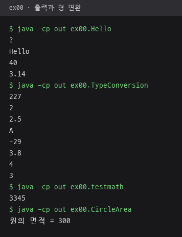 | 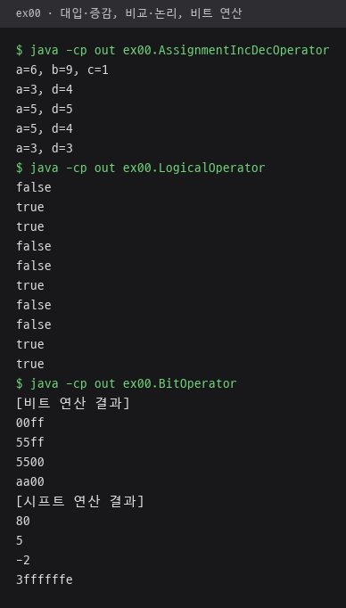 |
| **입력값 계산 · 3725초, 123456원, 100000원, 27 입력** | **점수 판정과 학점 계산** |
| 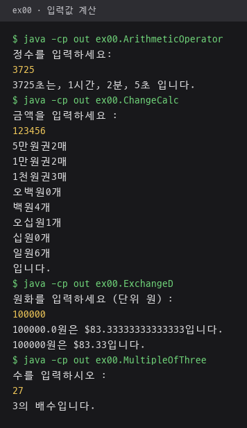 | 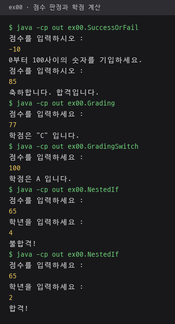 |
| **switch 문과 Scanner 입력** | **점·원·삼각형 판별** |
| 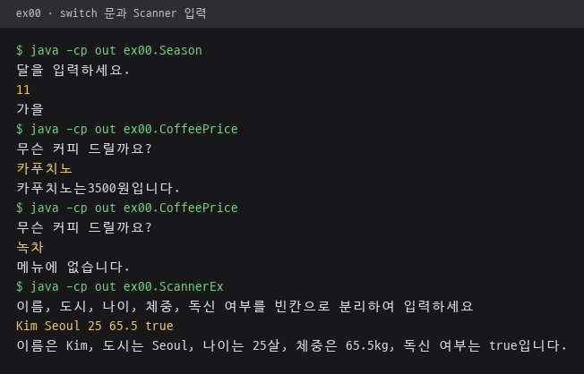 | 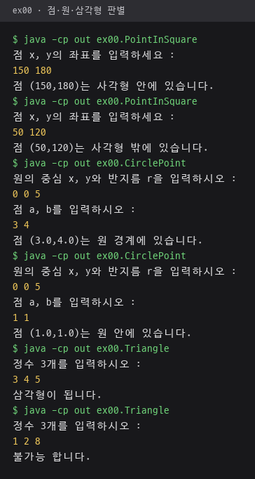 |

- `ExchangeD`: `double` 변수라 `+` 연결 줄은 `100000.0원`, `printf("%.0f원은 $%.2f입니다.")` 줄은 `100000원은 $83.33`
- `NestedIf`: 같은 65점이라도 4학년은 불합격, 2학년은 합격
- `CoffeePrice`: 메뉴에 없는 녹차 입력 시 "메뉴에 없습니다." 출력

---

## ex01 패키지 · 반복문, 배열, 예외 처리, 클래스와 객체

### 다룬 개념

| 개념 | 뜻과 사용 방법 |
|---|---|
| for 문 | 초기식, 조건식, 증감식을 한 줄에 쓰는 반복문. 증감식 자리에 출력문을 함께 넣는 형태도 사용 |
| while 문과 do-while 문 | while은 조건을 먼저 검사하고, do-while은 본문을 한 번 실행한 뒤 검사. -1이 입력될 때까지 정수를 받아 평균 계산 |
| `break`와 `continue` | `break`는 반복문 탈출, `continue`는 이번 반복의 남은 문장을 건너뛰고 다음 반복으로 이동 |
| 중첩 반복문 | 반복문 안의 반복문. 바깥은 행, 안쪽은 열을 맡아 구구단 표와 `*` 도형 출력 |
| 배열 | 같은 자료형 값을 인덱스로 관리하는 묶음. 배열을 메소드에 넘기면 참조가 전달되어 메소드 안의 수정이 원본에 반영 |
| 비정방형 2차원 배열 | 행마다 길이가 다른 2차원 배열. `new int[4][]`로 행만 만든 뒤 행별로 길이를 따로 할당 |
| 명령행 인자 | 프로그램 실행 시 넘긴 값이 들어오는 `main(String[] args)`의 `args` 배열 |
| 예외 처리 | 실행 중 오류를 `try`로 감싸고 `catch`에서 잡아 프로그램 중단을 막는 방법. `ArithmeticException`, `ArrayIndexOutOfBoundsException`, `InputMismatchException`, `NumberFormatException` 처리 |
| 클래스와 객체 | 클래스는 필드와 메소드를 묶은 설계도, 객체는 `new`로 만든 실체. 객체의 필드에 값을 넣고 면적 메소드 호출 |
| 생성자와 오버로딩 | 생성자는 객체를 만들 때 실행되는 메소드. 매개변수가 다른 생성자를 여러 개 두는 오버로딩, `this()`로 다른 생성자 호출 |
| `this` | 객체 자신을 가리키는 참조. 매개변수와 필드 이름이 같을 때 `this.title = title`로 구분 |
| 객체 배열 | 객체 참조를 담는 배열. 배열을 만든 뒤 원소마다 `new`로 객체를 따로 생성 |
| 객체 참조 대입 | 참조 변수끼리 대입하면 객체가 복사되지 않고 같은 객체를 함께 가리킴 |
| static 멤버 | 객체마다 따로 생기지 않고 클래스에 하나만 있는 필드와 메소드. 객체 생성 없이 `클래스이름.메소드()`로 호출 |

### 파일별 내용

| 파일 | 내용 | 핵심 코드 |
|---|---|---|
| [ForSample.java](src/ex01/ForSample.java) | 1부터 10까지 더하며 덧셈식과 합계를 한 줄로 출력 | `for(int i=1; i<=10; i++)`, `if (i <=9)` |
| [Scanner01.java](src/ex01/Scanner01.java) | 1부터 100까지 누적 합을 반복마다 출력, 출력문을 for 문의 증감식 자리에 배치. Scanner 입력은 쓰지 않는 예제 | `for(int i = 1; i<=100; i++, System.out.println(j))` |
| [WhileSample.java](src/ex01/WhileSample.java) | -1 입력 전까지 정수를 받아 개수와 평균 출력 | `while(n!=-1)`, `(double)sum/count` |
| [NewDoWhile.java](src/ex01/NewDoWhile.java) | 같은 평균 계산을 do-while로 구현, 첫 반복에서 늘어난 개수를 `count--`로 보정 | `do { ... } while(n!=-1)` |
| [DoWhileSample.java](src/ex01/DoWhileSample.java) | A부터 Z까지 알파벳 출력 | `ch = (char)(ch+1)`, `while ( ch <= 'Z')` |
| [BreakExample.java](src/ex01/BreakExample.java) | exit를 입력하면 반복 종료 | `text.equals("exit")`, `break` |
| [ContinueExample.java](src/ex01/ContinueExample.java) | 정수 다섯 개 중 양수만 합산 | `if(n<=0) continue;` |
| [NestedLoop.java](src/ex01/NestedLoop.java) | 구구단 전체를 탭으로 구분해 출력 | 이중 `for`, `'\t'` |
| [MakeStar.java](src/ex01/MakeStar.java) | 행·열 인덱스 조건식으로 이등변삼각형 테두리 `*` 도형 출력, 직각삼각형 테두리 코드는 주석으로 보존 | `j==i+4 \|\| j==4-i`, `i==4` |
| [MakeBF.java](src/ex01/MakeBF.java) | 세로선 세 개와 X자 대각선을 겹친 `*` 도형 출력 | `j==0 \|\| j==5 \|\| j==10`, `j==i \|\| j==10-i` |
| [MakeWM.java](src/ex01/MakeWM.java) | 가로·세로 중심선과 대각선, 끝이 한 방향으로 꺾인 테두리 선을 조합한 바람개비 모양 도형 출력 | `j==i \|\| j==9 \|\| j==18-i \|\| i==8`, `(j==0 && i<9)` |
| [MakeWM2.java](src/ex01/MakeWM2.java) | MakeWM의 대각선 대신 기울기가 다른 사선을 넣은 바람개비 도형 | `i==j*2-1 && i<9`, `j== 18-(i*3) && i<4` |
| [ArrayParameterEx.java](src/ex01/ArrayParameterEx.java) | 문자 배열을 메소드에 넘겨 공백과 마침표를 `!`로 바꾸고 원본 배열 변경 확인 | `static void replaceSpace(char a[])` |
| [ReturnArray.java](src/ex01/ReturnArray.java) | 메소드 안에서 만든 배열을 반환받아 출력 | `static int[] makeArray()` |
| [IrregularArray.java](src/ex01/IrregularArray.java) | 행마다 길이가 다른 2차원 배열에 값을 넣고 출력 | `new int[4][]`, `intArray[i].length` |
| [Calc.java](src/ex01/Calc.java) | 명령행 인자로 받은 실수 문자열을 모두 더한 합계 출력 | `Double.parseDouble(args[i])` |
| [CalcEx.java](src/ex01/CalcEx.java) | 정적 메소드만 가진 `Calc_2` 클래스로 절댓값, 큰 값, 작은 값 계산 | `Calc_2.abs(-5)`, 삼항 연산자 `(a>b)?a:b` |
| [DivideByZero.java](src/ex01/DivideByZero.java) | 입력한 두 정수의 몫과 나머지 출력, 예외 처리 없는 형태 | `dividend/divisor`, `dividend%divisor` |
| [DevideByZeroHandling.java](src/ex01/DevideByZeroHandling.java) | 0으로 나누면 `ArithmeticException`을 잡아 다시 입력받고, 계산이 되면 반복 종료 | `catch(ArithmeticException e)` |
| [ArrayException.java](src/ex01/ArrayException.java) | 크기 5 배열에서 `intArray[i+1]`에 값을 넣다 범위를 벗어나는 순간 예외 메시지 출력 | `catch(ArrayIndexOutOfBoundsException e)` |
| [InputException.java](src/ex01/InputException.java) | 정수 세 개를 입력받다 정수가 아닌 입력은 `scanner.next()`로 버리고 같은 순번 재입력 | `catch(InputMismatchException e)`, `i--` |
| [NumException.java](src/ex01/NumException.java) | 문자열 배열을 정수로 바꾸다 소수 문자열에서 예외가 나면 메시지 출력 | `Integer.parseInt`, `NumberFormatException` |
| [Rectangle.java](src/ex01/Rectangle.java) | 너비와 높이를 입력받아 사각형 객체의 면적 계산 | `rect.width = scanner.nextInt()`, `getArea()` |
| [Circle.java](src/ex01/Circle.java) | 반지름을 1부터 10 사이 난수로 정한 원 객체 두 개의 면적 출력 | `rd.nextInt(max - min +1)+min` |
| [Circle_2.java](src/ex01/Circle_2.java) | 기본 생성자와 매개변수 생성자 두 가지로 원 객체 생성 | `Circle_2()`, `Circle_2(int r, String n)` |
| [Circle_3.java](src/ex01/Circle_3.java) | 참조 변수 대입 뒤 두 변수가 같은 객체를 가리키는지 반지름으로 확인 | `ob1 = ob2` |
| [CircleArray.java](src/ex01/CircleArray.java) | 원 객체를 배열에 담아 반지름별 면적 출력 | `new Circle_4[5]`, `c[i] = new Circle_4(i)` |
| [Book.java](src/ex01/Book.java) | 제목만 받는 생성자는 저자를 "작자 미상"으로 지정, 생성자 오버로딩 | `Book(String t)`, `Book(String t, String a)` |
| [Book_2.java](src/ex01/Book_2.java) | `this()`로 생성자끼리 호출을 연결 | `this(title, "작자미상")`, `this("","")` |
| [BookArray.java](src/ex01/BookArray.java) | 책 제목과 저자를 입력받아 객체 배열에 저장 후 출력 | `Book_3 [] book_3 = new Book_3[2]`, `nextLine()` |
| [StaticMember.java](src/ex01/StaticMember.java) | 환율을 입력받아 정적 필드에 저장하고 정적 메소드로 원화와 달러 환산 | `private static double rate`, `CurrencyConverter.toDollar(1000000)` |

### 실행 결과

반복문 실행 결과. `WhileSample`과 `NewDoWhile`에 같은 입력값 `10 20 30 45 -1`을 넣어 같은 개수 4개, 평균 26.25 확인.

| for, do-while, while, break, continue | Scanner01 누적 합 출력 앞부분 |
|---|---|
| 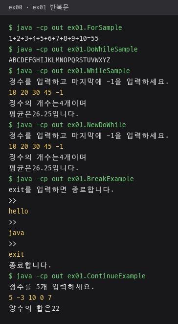 | 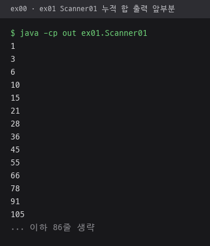 |

중첩 반복문으로 출력한 구구단.

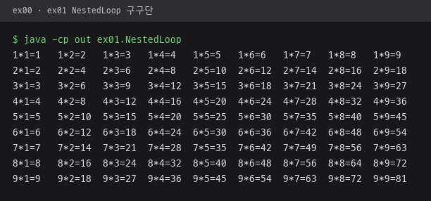

행·열 인덱스 조건식으로 출력한 `*` 도형.

| MakeStar, MakeBF | MakeWM, MakeWM2 |
|---|---|
| 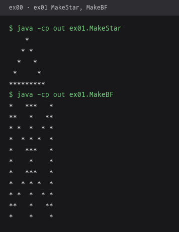 | 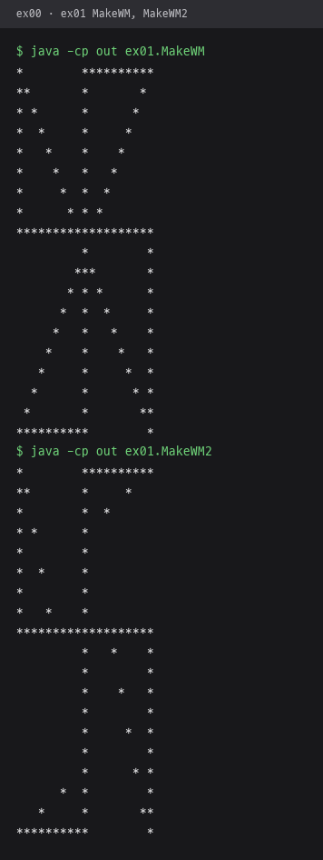 |

배열, 예외 처리, 클래스. `DivideByZero`는 나눗수 0 입력 시 예외로 종료, `DevideByZeroHandling`은 같은 입력에서 재입력 요청.

| 배열 매개변수, 배열 반환, 비정방형 배열, 명령행 인자 | 0으로 나누기와 배열 범위 예외 |
|---|---|
| 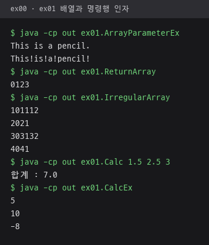 | 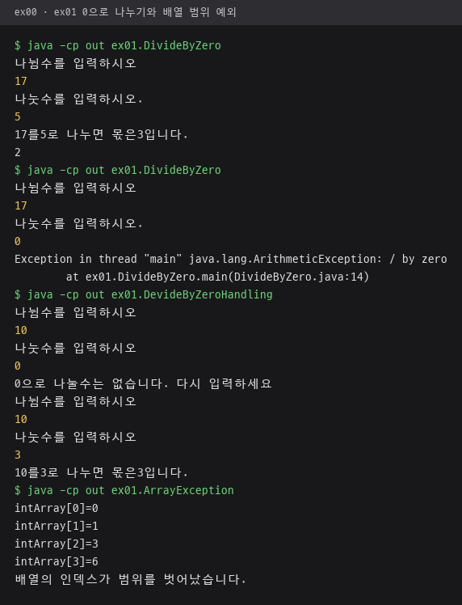 |
| **입력 예외와 숫자 변환 예외** | **클래스와 객체** |
| 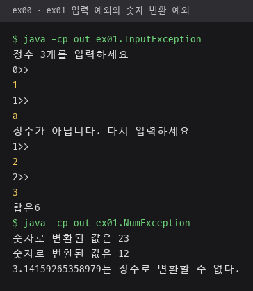 | 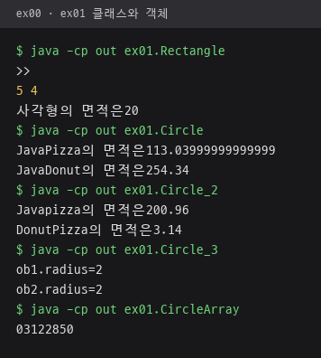 |

생성자 오버로딩, `this()` 호출, 객체 배열 입력, 정적 멤버 환율 변환.

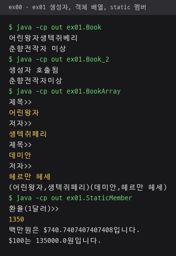

- `Calc`: 명령행 인자 `1.5 2.5 3`의 합계 7.0
- `Circle`, `Circle_2`: 반지름이 1부터 10 사이 난수라 실행할 때마다 면적 변화
- `CircleArray`: 반지름 0부터 4까지의 면적을 `int`로 바꿔 구분자 없이 이어 붙인 `03122850` 출력
- `StaticMember`: 환율 1350 입력 시 백만원은 약 740.74달러, 100달러는 135000원

---

## ex02 패키지 · 상속, 다형성, 인터페이스, 주요 클래스

### 다룬 개념

| 개념 | 뜻과 사용 방법 |
|---|---|
| 상속 | 부모 클래스의 필드와 메소드를 자식 클래스가 물려받는 구조. `class ColorPoint extends Point` |
| `super()` | 자식 생성자에서 부모 생성자를 호출하는 문장. `super(x,y)`로 좌표 초기화를 부모 생성자에 맡김 |
| `instanceof` | 객체가 특정 클래스나 그 자식 클래스의 객체인지 검사하는 연산자 |
| 메소드 오버라이딩 | 부모 메소드를 자식 클래스에서 같은 이름과 매개변수로 다시 정의하는 일. `draw()`를 Line, Rect, Circle마다 재정의 |
| 다형성과 동적 바인딩 | 부모 타입 변수로 자식 객체를 다루면 실행 시점의 실제 객체 메소드가 호출되는 성질. `paint(Shape p)` 하나로 도형마다 다른 출력 |
| 추상 클래스 | `abstract` 메소드를 가진 클래스. 객체를 만들 수 없고 자식 클래스가 추상 메소드를 모두 구현 |
| 인터페이스 | 구현할 메소드 목록을 정한 타입. 상수 필드, 추상 메소드, 구현 내용을 가진 `default` 메소드 포함 |
| 인터페이스 상속과 다중 구현 | 인터페이스끼리는 `extends`로 확장하고, 클래스는 `extends` 하나와 `implements` 여러 개를 함께 사용 |
| Object 클래스 | 모든 클래스의 최상위 부모. `getClass()`, `hashCode()`, `toString()`, `equals()` 제공 |
| `==`와 `equals()` | `==`는 같은 객체인지 참조를 비교하고, 재정의한 `equals()`는 좌표나 넓이 같은 내용을 비교 |
| String과 StringBuffer | String은 내용이 바뀌지 않아 메소드마다 새 문자열을 반환하고, StringBuffer는 한 객체 안에서 추가·삽입·삭제 |
| StringTokenizer | 구분 문자로 문자열을 잘라 토큰 단위로 꺼내는 클래스 |
| Wrapper 클래스 | 기본 자료형 값을 객체로 감싸는 `Integer`, `Double`, `Character`, `Boolean`. 문자열 변환과 문자 판별 메소드 제공 |
| 오토박싱과 언박싱 | 기본 자료형과 Wrapper 객체 사이의 자동 변환. `Integer intObject = n`, `int m = intObject + 10` |
| Math와 Calendar | `Math`는 올림, 내림, 제곱근, 난수 같은 수학 계산, `Calendar`는 날짜와 시간 값 조회·지정 |

### 파일별 내용

| 파일 | 내용 | 핵심 코드 |
|---|---|---|
| [Point.java](src/ex02/Point.java) | `main()` 없이 좌표 클래스 `Point`와 색상을 더한 자식 클래스 `ColorPoint` 정의, SuperEX와 ObjectPropertyEx에서 사용 | `super(x,y)`, `showPoint()` |
| [SuperEX.java](src/ex02/SuperEX.java) | `ColorPoint` 객체를 만들어 색상과 좌표 출력 | `new ColorPoint(5,6,"blue")` |
| [InstanceOfEx.java](src/ex02/InstanceOfEx.java) | Person을 상속한 Student, Researcher, Professor 객체마다 `instanceof`가 참인 타입 출력 | `p instanceof Researcher` |
| [MethodOverridingEx.java](src/ex02/MethodOverridingEx.java) | Shape를 상속한 Line, Rect, Circle의 `draw()` 재정의, 같은 `paint()` 호출로 다른 결과 | `static void paint(Shape p)` |
| [UsingOverride.java](src/ex02/UsingOverride.java) | 같은 다형성 예제에 `next` 참조로 도형 객체를 차례로 연결하고 `while` 반복으로 순회 출력 | `last.next = obj`, `p = p.next` |
| [Goodcalc.java](src/ex02/Goodcalc.java) | 추상 클래스 Calculator의 덧셈, 뺄셈, 평균 추상 메소드 구현 | `abstract class Calculator`, `@Override` |
| [InterfaceEx.java](src/ex02/InterfaceEx.java) | 전화 인터페이스의 추상 메소드 구현과 default 메소드 호출 | `interface PhoneInterface`, `default void printLogo()` |
| [InterfaceEx_2.java](src/ex02/InterfaceEx_2.java) | PDA 클래스를 상속하고 휴대폰 인터페이스와 MP3 인터페이스를 함께 구현한 SmartPhone | `class SmartPhone extends PDA implements MobilePhoneInterface, MP3Interface` |
| [ObjectPropertyEx.java](src/ex02/ObjectPropertyEx.java) | Object 타입 매개변수로 받은 객체의 클래스 이름, 해시코드, 문자열 표현 출력. 같은 파일의 `Point_2` 대신 Point.java의 `Point` 객체 전달 | `obj.getClass().getSimpleName()`, `obj.hashCode()` |
| [ToStringEx.java](src/ex02/ToStringEx.java) | `toString()` 재정의로 객체를 `Point(2,3)` 형태 문자열로 출력 | `public String toString()`, `p + "입니다."` |
| [EqualsEx.java](src/ex02/EqualsEx.java) | `==` 비교와 좌표 값으로 재정의한 `equals()` 비교 결과 차이 | `a == b`, `a.equals(b)` |
| [EqualsEx2.java](src/ex02/EqualsEx2.java) | 너비와 높이가 달라도 넓이가 같으면 같은 사각형으로 보는 `equals()` | `width*height == p.width*p.height` |
| [StringEx.java](src/ex02/StringEx.java) | String의 길이, 포함 여부, 연결, 공백 제거, 치환, 분리, 부분 문자열, 문자 추출 | `concat`, `trim`, `replace`, `split(",")`, `substring(5)`, `charAt(2)` |
| [MyStringEx.java](src/ex02/MyStringEx.java) | String의 `concat`, `trim`, `replace`를 문자 단위 반복문으로 구현한 MyString 클래스. 이 `trim`은 문자열 안의 공백을 모두 제거, `split`과 `substring`은 빈 문자열을 반환하는 메소드 틀 | `str.charAt(i)`, 레이블 반복문 `break out` |
| [StringBufferEx.java](src/ex02/StringBufferEx.java) | StringBuffer에 문자열 추가, 삽입, 치환, 삭제 후 길이 줄이기 | `append`, `insert`, `replace`, `delete`, `setLength(4)` |
| [stringTokenizerEx.java](src/ex02/stringTokenizerEx.java) | `/`로 구분한 이름 문자열을 토큰 단위로 출력 | `new StringTokenizer(..., "/")`, `hasMoreTokens()` |
| [WrapperEx.java](src/ex02/WrapperEx.java) | Character 판별, Integer 문자열 변환과 16진수·2진수 변환, Double과 Boolean 변환 | `Character.isDigit`, `Integer.toBinaryString(28)`, `Boolean.parseBoolean` |
| [AutoBoxingUnBoxingEx.java](src/ex02/AutoBoxingUnBoxingEx.java) | `int`와 `Integer` 사이 자동 변환 | `Integer intObject = n` |
| [MathEx.java](src/ex02/MathEx.java) | 원주율 올림·내림, 제곱근, 지수, 반올림, 1부터 45 사이 정수 난수 출력 | `Math.ceil`, `Math.sqrt`, `(int)(Math.random()*45 + 1)` |
| [CalendarEx.java](src/ex02/CalendarEx.java) | 현재 날짜·시간과 지정한 날짜를 년, 월, 일, 요일, 오전·오후, 시분초로 출력 | `Calendar.getInstance()`, `cal.get(Calendar.MONTH)+1`, `firstDate.set(2016, 11, 25)` |

### 실행 결과

| 상속과 오버라이딩 | 추상 클래스와 인터페이스 |
|---|---|
| 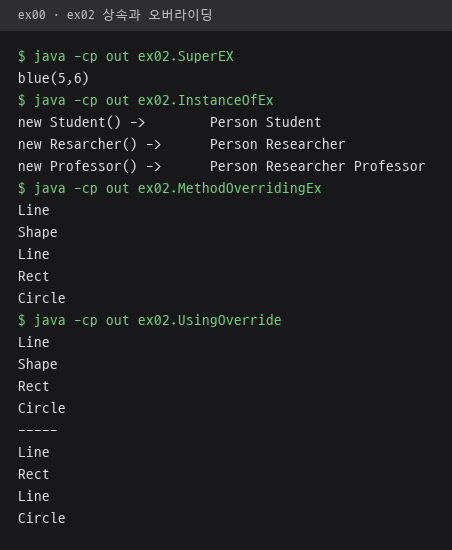 | 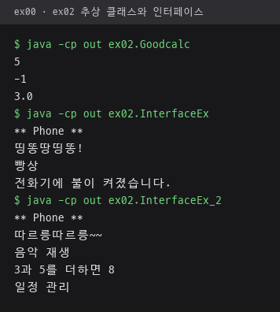 |
| **Object 클래스 메소드** | **String, MyString, StringBuffer, StringTokenizer** |
| 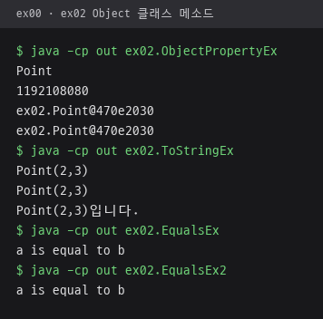 | 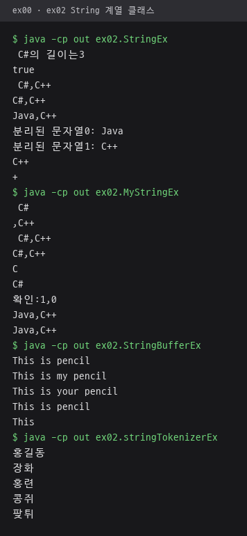 |

Wrapper 클래스, 오토박싱, Math, Calendar. `MathEx`의 행운의 번호와 `CalendarEx`의 현재 시각은 실행 시점마다 다른 값.

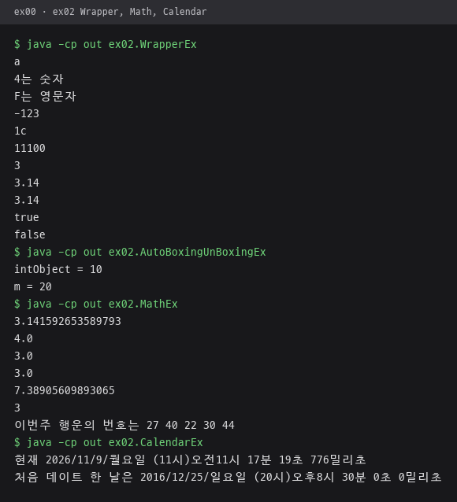

- `InstanceOfEx`: `Professor` 객체는 `Person`, `Researcher`, `Professor` 세 타입 모두에 `instanceof` 참
- `ObjectPropertyEx`: 해시코드 1192108080의 16진수 값 `470e2030`이 `toString()` 결과의 `@` 뒤에 그대로 표시
- `WrapperEx`: `Integer.toHexString(28)`은 `1c`, `Integer.toBinaryString(28)`은 `11100`

---

## ex03 패키지 · 컬렉션과 제네릭

### 다룬 개념

| 개념 | 뜻과 사용 방법 |
|---|---|
| 컬렉션 | 여러 객체를 담고 크기가 자동으로 늘어나는 `java.util` 패키지의 자료구조 클래스 |
| 타입 매개변수 지정 | `Vector<Integer>`, `ArrayList<String>`처럼 컬렉션에 담을 자료형을 정하는 문법. 꺼낼 때 형 변환 불필요 |
| Vector와 ArrayList | 인덱스로 접근하는 가변 길이 리스트. `add`, `add(인덱스, 값)`, `get`, `remove`, `size`, Vector의 `capacity` |
| LinkedList와 Collections | LinkedList는 요소끼리 연결해 저장하는 리스트. `Collections.sort`, `reverse`, `binarySearch`로 정렬, 역순, 검색 |
| Iterator | 컬렉션 요소를 처음부터 차례로 꺼내는 반복자. `hasNext()`로 남은 요소 확인, `next()`로 꺼냄 |
| HashMap | 키와 값을 쌍으로 저장하고 키로 값을 찾는 컬렉션. 없는 키는 `null` 반환, `keySet()`으로 키 목록 조회 |
| 제네릭 클래스 | 타입 매개변수 `T`로 자료형을 나중에 정하는 클래스. `GStack<T>` 하나로 String 스택과 Integer 스택 생성 |
| 제네릭 메소드 | 반환형 앞에 `<T>`를 붙여 호출할 때 자료형이 정해지는 메소드 |

### 파일별 내용

| 파일 | 내용 | 핵심 코드 |
|---|---|---|
| [VectorEx.java](src/ex03/VectorEx.java) | Integer 벡터에 값 추가와 중간 삽입 후 요소 수, 현재 용량, 합계 출력 | `v.add(2,100)`, `v.capacity()`, `v.elementAt(i)` |
| [PointVectorEx.java](src/ex03/PointVectorEx.java) | Point 객체 벡터에서 인덱스 1 요소를 지운 뒤 출력 | `Vector<Point>`, `v.remove(1)` |
| [IteratorEx.java](src/ex03/IteratorEx.java) | 벡터를 Iterator로 두 번 순회하며 요소 출력과 합계 계산 | `v.iterator()`, `it.hasNext()` |
| [ArrayListEx.java](src/ex03/ArrayListEx.java) | 이름 네 개를 입력받아 ArrayList에 저장하고 가장 긴 이름 출력 | `ArrayList<String>`, `a.get(i).length()` |
| [CollectionsEx.java](src/ex03/CollectionsEx.java) | 영화 제목 LinkedList를 정렬·역순으로 바꿔 `->` 연결 형태로 출력, 이진 검색으로 위치 확인 | `Collections.sort(myList)`, `Collections.binarySearch(myList, "아바타")` |
| [HashMapDicEx.java](src/ex03/HashMapDicEx.java) | 영어 단어를 입력하면 한글 뜻을 찾는 사전, exit 입력 시 종료 | `HashMap<String, String>`, `dic.get(eng)` |
| [HashMapScoreEx.java](src/ex03/HashMapScoreEx.java) | 이름과 점수를 저장하고 키 집합을 Iterator로 순회 출력 | `scoreMap.keySet()`, `keys.iterator()` |
| [HashMapStudentEx.java](src/ex03/HashMapStudentEx.java) | 이름을 키로 학생 객체를 저장, 이름 검색 시 ID와 전화번호 출력 | `HashMap<String, Student>` |
| [MyStack.java](src/ex03/MyStack.java) | `Object` 배열 기반 제네릭 스택 `GStack<T>` 구현, 문자열 스택과 정수 스택에 push·pop | `class GStack<T>`, `return (T)stck[tos]` |
| [GenricMethodExample.java](src/ex03/GenricMethodExample.java) | 스택 요소를 꺼내 새 스택에 넣어 순서를 뒤집는 제네릭 메소드, MyStack.java의 GStack 사용 | `public static <T> GStack<T> reverse(GStack<T> a)` |
| [FileReaderEx.java](src/ex03/FileReaderEx.java) | 내용이 빈 클래스 선언. 파일 읽기 예제는 ex04 패키지의 같은 이름 파일 | `public class FileReaderEx { }` |

### 실행 결과

| Vector, Iterator, ArrayList | Collections와 HashMap 사전 |
|---|---|
| 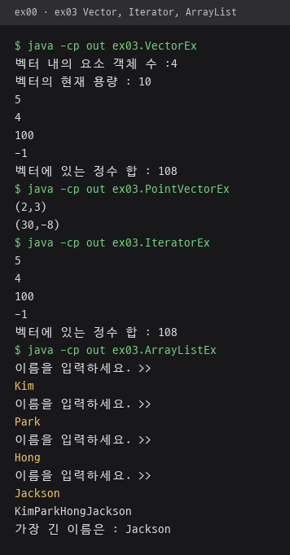 | 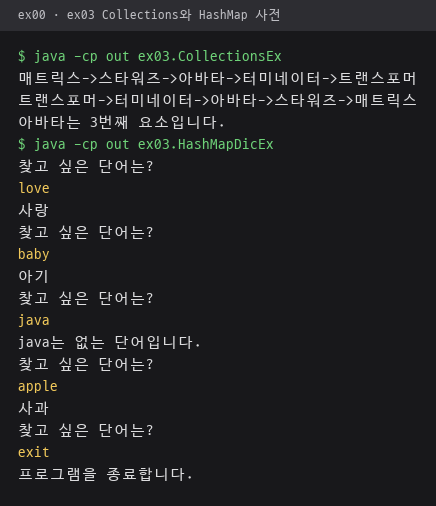 |

제네릭 스택 `GStack<T>`에 넣은 값을 꺼낸 순서와 제네릭 메소드로 뒤집은 스택 출력.

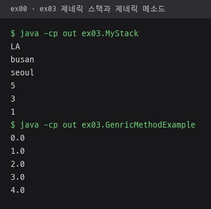

- `VectorEx`: 요소 4개, 기본 용량 10, 합계 108
- `ArrayListEx`: 입력한 이름 네 개 중 가장 긴 Jackson 출력
- `HashMapDicEx`: 사전에 없는 java는 없는 단어 안내, exit 입력 시 종료

---

## ex04 패키지 · 파일 입출력

### 다룬 개념

| 개념 | 뜻과 사용 방법 |
|---|---|
| 스트림 | 데이터가 한 방향으로 흐르는 통로. 입력 스트림으로 읽고 출력 스트림으로 씀 |
| 문자 스트림 | 문자 단위로 읽고 쓰는 `FileReader`, `FileWriter`. 텍스트 파일 처리 |
| 바이트 스트림 | 바이트 단위로 읽고 쓰는 `FileInputStream`, `FileOutputStream`. 바이너리 값을 그대로 기록 |
| `InputStreamReader` | 바이트 스트림을 지정한 문자 집합으로 해석해 문자 스트림으로 바꾸는 클래스. `"UTF-8"`을 지정해 한글 파일 읽기 |
| 버퍼 스트림 | 데이터를 버퍼에 모았다가 한 번에 내보내는 스트림. `flush()` 호출 시 버퍼에 남은 내용 출력 |
| 파일 끝 판별 | `read()`가 `-1`을 반환하면 파일 끝 |
| `File` 클래스 | 파일과 디렉토리의 경로, 종류, 크기, 수정 시간 조회와 디렉토리 생성·이름 변경 |
| `IOException` 처리 | 입출력 중 발생하는 예외를 `try-catch`로 처리하고 오류 메시지 출력 |

### 파일별 내용

| 파일 | 내용 | 핵심 코드 |
|---|---|---|
| [FileReaderEx.java](src/ex04/FileReaderEx.java) | `c:\windows\system.ini`를 한 문자씩 읽어 화면 출력 | `new FileReader(...)`, `while ((c = fin.read()) != -1)` |
| [FileWriterEx.java](src/ex04/FileWriterEx.java) | 키보드로 입력한 줄을 빈 줄 입력 전까지 `c:\Temp\test.txt`에 저장 | `fout.write(line, 0, line.length())`, `fout.write("\r\n",0,2)` |
| [FileOutputStreamEx.java](src/ex04/FileOutputStreamEx.java) | byte 배열 값을 `c:\Temp\test.out`에 그대로 기록 | `new FileOutputStream(...)`, `fout.write(b[i])` |
| [FileInputStreamEx.java](src/ex04/FileInputStreamEx.java) | `c:\Temp\test.out`을 바이트 단위로 읽어 배열에 담아 출력 | `b[n] = (byte)c` |
| [FileReadHangulSuccess.java](src/ex04/FileReadHangulSuccess.java) | UTF-8 한글 파일 `c:\Temp\hangul.txt`를 읽고 사용한 인코딩 이름 출력 | `new InputStreamReader(fin, "UTF-8")`, `in.getEncoding()` |
| [BufferedIOEx.java](src/ex04/BufferedIOEx.java) | `c:\Temp\test2.txt` 내용을 크기 5 버퍼의 출력 스트림으로 화면에 쓰고, Enter 입력 뒤 `flush()`로 남은 내용 출력 | `new BufferedOutputStream(System.out, 5)`, `out.flush()` |
| [FileEx.java](src/ex04/FileEx.java) | 파일 경로 정보와 파일·디렉토리 구분 출력, `c:\Temp\java_sample` 디렉토리 생성과 이름 변경 전후의 목록 출력 | `getParent()`, `isFile()`, `mkdirs()`, `renameTo()`, `listFiles()` |

파일 경로는 `c:\Temp`, `c:\windows\system.ini` 고정. FileEx, FileWriterEx, FileOutputStreamEx는 `c:\Temp` 아래에 파일이나 디렉토리를 만들거나 이름을 바꾸는 예제.

### 실행 결과

`FileReadHangulSuccess`와 `BufferedIOEx`가 읽는 `c:\Temp\hangul.txt`, `c:\Temp\test2.txt`는 실행 전에 만든 입력 파일.

| FileReader로 system.ini 읽기 | 바이트 스트림 쓰기와 읽기 |
|---|---|
| 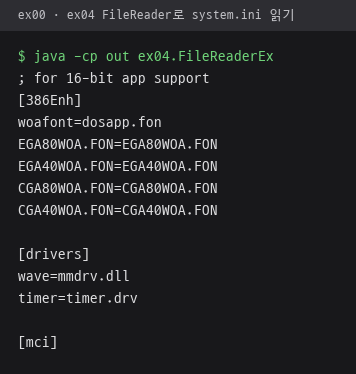 | 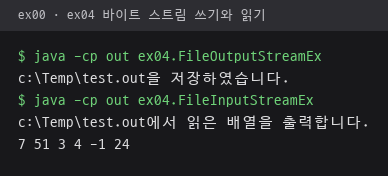 |
| **FileWriter 저장 뒤 type으로 확인, UTF-8 한글 파일 읽기** | **크기 5 버퍼 출력 스트림** |
| 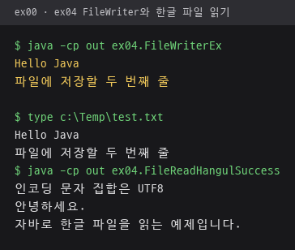 | 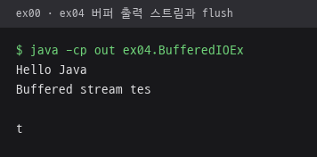 |

- `FileWriterEx`: 빈 줄을 입력할 때까지 받은 두 줄이 `c:\Temp\test.txt`에 저장
- `BufferedIOEx`: 5바이트가 찰 때마다 화면에 출력되고, 버퍼에 남은 마지막 `t`와 줄바꿈은 Enter 입력 뒤 `flush()`에서 출력
- `FileEx`: 아래는 경로 정보와 파일 구분 출력 부분. 이어지는 `c:\Temp` 목록은 PC마다 내용이 달라 생략

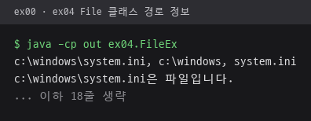
