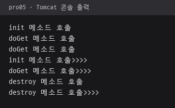

# pro05 · 서블릿 생명주기

`HttpServlet`을 상속한 FirstServlet과 SecondServlet을 `web.xml`에 등록하고, 요청 시점마다 호출되는 생명주기 메소드를 콘솔 출력으로 확인한 웹 프로젝트.

## 다룬 개념

| 개념 | 뜻과 사용 방법 |
|---|---|
| 서블릿 | 웹 서버 안에서 브라우저 요청을 받아 응답을 만드는 Java 클래스. `javax.servlet.http.HttpServlet` 상속 |
| 서블릿 컨테이너 | 서블릿 객체를 만들고 요청이 올 때마다 메소드를 호출하는 서버 구성 요소. Tomcat이 이 역할 |
| 생명주기 메소드 | 첫 요청 때 한 번 실행되는 `init()`, GET 요청마다 실행되는 `doGet()`, 서블릿이 내려갈 때 실행되는 `destroy()` |
| `web.xml` 서블릿 등록 | 웹 애플리케이션 설정 파일. `<servlet>`에 서블릿 이름과 클래스를, `<servlet-mapping>`에 그 이름과 요청 경로를 짝지어 등록 |

## 요청 흐름

1. 브라우저가 `/pro05/first` 요청
2. 컨테이너가 `web.xml`의 `<url-pattern>/first</url-pattern>`에서 서블릿 이름 `aaa`를 찾고, `<servlet>`에 적힌 `ex01.ex01.FirstServlet` 클래스 확인
3. 첫 요청이면 서블릿 객체를 만들고 `init()` 호출, 콘솔에 "init 메소드 호출" 출력
4. `doGet()` 호출, 콘솔에 "doGet 메소드 호출" 출력. 브라우저로 보내는 응답 본문은 작성하지 않는 구조
5. 같은 주소를 다시 요청하면 `init()` 없이 `doGet()`만 실행
6. 서버 종료나 재배포 때 `destroy()` 호출

`/second`는 같은 방식으로 서블릿 이름 `bbb`를 거쳐 SecondServlet에 연결.

## 실행 결과

Tomcat 9.0.118에 pro05만 배포한 뒤 `/pro05/first`를 두 번, `/pro05/second`를 한 번 요청하고 서버를 종료할 때까지 콘솔에 찍힌 출력. 첫 요청에만 `init()`, 요청마다 `doGet()`, 종료 때 `destroy()` 호출 확인. 브라우저 화면은 응답 본문이 없어 빈 페이지.

## 파일별 역할

| 파일 | 역할 | 핵심 코드 |
|---|---|---|
| [FirstServlet.java](src/main/java/ex01/ex01/FirstServlet.java) | `/first` 요청 처리, 생명주기 메소드마다 콘솔 메시지 출력 | `init()`, `doGet()`, `destroy()` |
| [SecondServlet.java](src/main/java/ex01/ex01/SecondServlet.java) | `/second` 요청 처리, 메시지 끝에 `>>>>`를 붙여 FirstServlet 출력과 구분 | `init()`, `doGet()`, `destroy()` |
| [web.xml](src/main/webapp/WEB-INF/web.xml) | 서블릿 이름 `aaa`·`bbb`와 클래스, 요청 경로 `/first`·`/second` 연결, 시작 파일 목록 | `<servlet>`, `<servlet-mapping>`, `<url-pattern>` |
