# pro06 · 서블릿 요청 처리와 응답

HTML 폼에서 보낸 값을 서블릿이 받아 콘솔과 HTML 응답으로 출력하는 단계. 환율 계산기, 구구단 표, 아이디에 따라 달라지는 로그인 결과 화면 구현.

이전 단계와 차이: pro05는 `web.xml`에 서블릿을 등록했지만, pro06은 클래스 위의 `@WebServlet` 애너테이션으로 요청 경로 연결. `web.xml`에는 시작 파일 목록만 존재.

## 다룬 개념

| 개념 | 뜻과 사용 방법 |
|---|---|
| `@WebServlet` | 서블릿 클래스 위에 요청 경로를 적어 매핑하는 애너테이션. `@WebServlet("/calc")`처럼 `web.xml` 등록 없이 연결 |
| GET과 POST | 폼 전송 방식. GET은 값을 주소 뒤 쿼리 문자열에 붙이고, POST는 요청 본문에 담아 전송. 서블릿은 각각 `doGet()`, `doPost()`로 처리 |
| 요청 매개변수 | 폼 입력 요소의 `name`과 입력값 쌍. `getParameter("user_id")`로 값 하나, 같은 이름의 체크박스 값 여러 개는 `getParameterValues()`, 전체 이름 목록은 `getParameterNames()` |
| 한글 인코딩 지정 | `request.setCharacterEncoding("utf-8")`로 요청 값 해석 방식, `response.setContentType("text/html;charset=utf-8")`로 응답 형식과 문자 집합 지정 |
| `PrintWriter` 응답 | `response.getWriter()`로 얻은 출력 스트림에 HTML 문자열을 써서 브라우저로 전송 |
| hidden 필드 | 화면에 보이지 않고 값만 전송되는 `<input type="hidden">`. 환율 계산기의 `command=calculate`, 로그인 폼의 주소 값 전달에 사용 |
| 자바스크립트 입력 검사 | 전송 전에 빈 값을 검사해 `alert()`로 알리고, 통과하면 폼의 `method`와 `action`을 지정한 뒤 `submit()` |

## 요청 흐름

환율 계산기 CalcServlet 기준.

1. 브라우저가 `/pro06/calc`를 GET으로 요청
2. `@WebServlet("/calc")`가 붙은 CalcServlet의 `doGet()` 실행
3. `command` 값이 없으면 원화 입력칸, 통화 선택 목록, hidden `command=calculate`가 들어 있는 폼 HTML 출력
4. 변환 버튼을 누르면 같은 주소로 `won`, `operator`, `command`를 GET 전송
5. `calculate()`가 통화별 환율 상수로 원화를 나눈 결과 문자열을 만들고, 결과 화면과 계산기로 돌아가는 링크 출력

폼 화면과 처리 서블릿 연결.

| 폼 화면 | 전송 방식과 주소 | 처리 서블릿 | 응답 |
|---|---|---|---|
| input.html | GET `input` | InputServlet | 아이디, 비밀번호, 선택 과목을 콘솔 출력 |
| input2.html | GET `input2` | InputServlet2 | 모든 매개변수 이름과 값을 콘솔 출력 |
| login.html | GET `login` | LoginServlet | 아이디, 비밀번호를 콘솔 출력 |
| login2.html | GET `login2` | LoginServlet2 | 아이디, 비밀번호를 HTML로 출력 |
| login5.html | 입력 검사 후 POST `login5` | LoginSurvlet5 | 아이디, 비밀번호, hidden 주소를 HTML로 출력. 처리 메소드는 `doPost()` |
| login_test.html | POST `/pro06/loginTest` | LoginTest | 아이디가 있으면 환영 문구, 없으면 로그인 창 링크 |
| login_test2.html | POST `/pro06/loginTest2` | LoginTest2 | `admin`이면 관리자 문구와 회원정보 수정·삭제 버튼, 다른 아이디면 환영 문구 |
| guguTest.html | POST `/pro06/guguTest` | GuguTest | 입력한 단의 구구단 표 |
| guguTest2.html | POST `/pro06/guguTest2` | GuguTest2 | 짝수 행과 홀수 행 배경색을 달리한 구구단 표 |
| 폼 없이 주소창 접속 | GET `/pro06/calc` | CalcServlet | 환율 계산기 폼과 변환 결과 |

## 실행 결과

Tomcat 9.0.118에 배포해 브라우저로 요청한 화면. 콘솔에만 출력하는 서블릿은 폼 전송 뒤 Tomcat 콘솔 내용을 함께 첨부.

환율 계산기 `/pro06/calc`에서 100000원을 달러와 엔화로 변환한 결과.

| 계산기 폼 | 달러 변환 결과 | 엔화 변환 결과 |
|---|---|---|
| 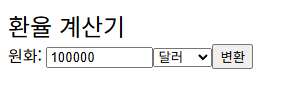 | 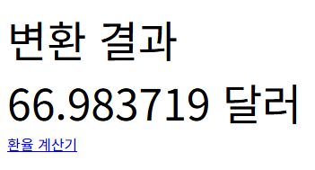 | 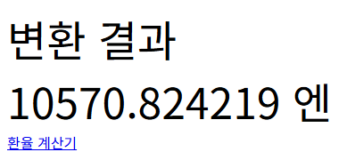 |

아이디에 따라 달라지는 로그인 결과 `login_test.html`, `login_test2.html`.

| login_test.html에 hong 입력 | LoginTest 응답 | 아이디 없이 전송 |
|---|---|---|
| 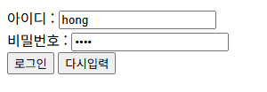 | 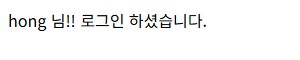 | 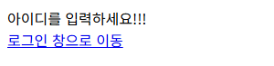 |
| **login_test2.html에 admin 입력** | **login_test2.html에 lee 입력** | |
| 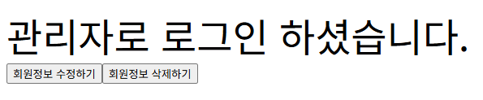 |  | |

구구단. 단 입력 폼에 7을 넣어 `guguTest`, 8을 넣어 `guguTest2`로 전송한 결과.

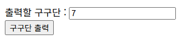

| GuguTest 7단 | GuguTest2 8단 |
|---|---|
| 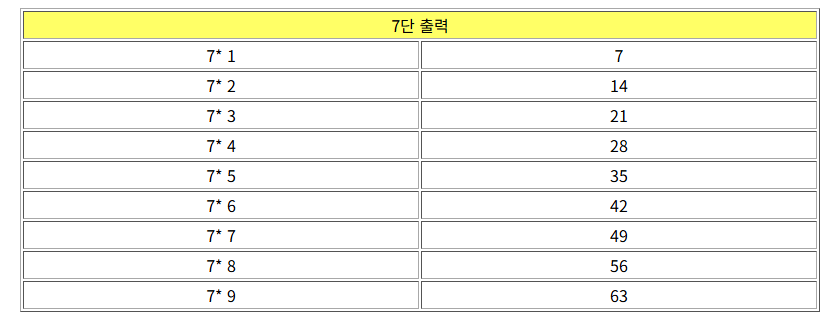 | 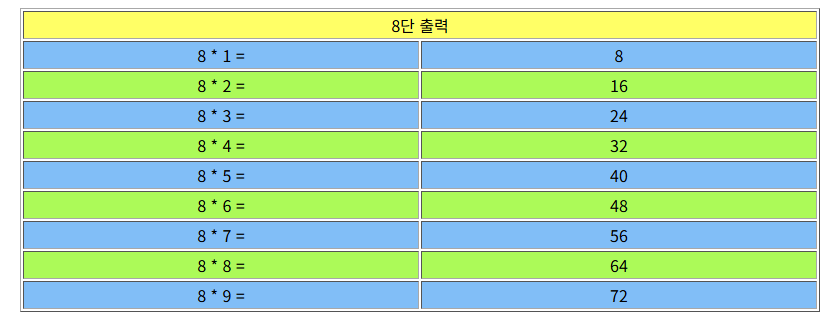 |

콘솔 출력 서블릿. 폼 전송 뒤 Tomcat 콘솔에 찍힌 내용.

| 입력 폼 | 전송 뒤 Tomcat 콘솔 출력 |
|---|---|
| 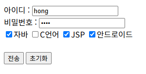 | 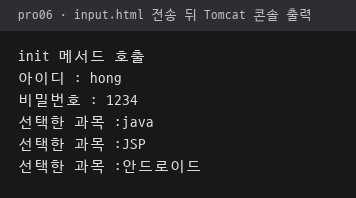 |
| 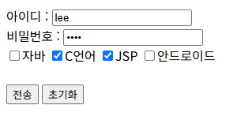 | 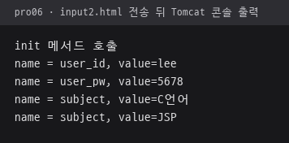 |
| 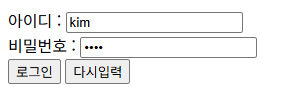 | 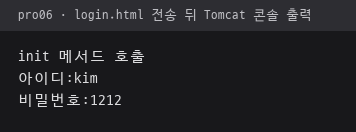 |

HTML로 응답하는 로그인과 자바스크립트 입력 검사.

| login2.html 입력 | LoginServlet2 응답 | login5.html 빈 칸으로 로그인 클릭 |
|---|---|---|
| 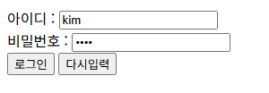 | 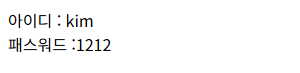 | 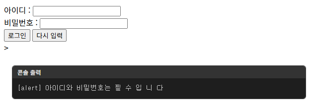 |

`login5.html` 화면 아래 `콘솔 출력` 상자는 페이지 요소가 아닌 캡처 때 `alert()` 문구를 옮겨 적은 상자.

login5.html에 아이디와 비밀번호를 모두 넣고 로그인을 누르면 입력 검사를 통과해 POST로 전송되고, hidden 주소까지 함께 출력.

| login5.html 입력 | LoginSurvlet5 응답 |
|---|---|
| 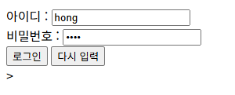 | 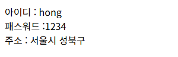 |

## 파일별 역할

| 파일 | 역할 | 핵심 코드 |
|---|---|---|
| [CalcServlet.java](src/main/java/ex01/ex01/CalcServlet.java) | 달러, 엔, 위안, 파운드, 유로 환율 계산기. 폼 출력과 계산 결과 출력을 `command` 값으로 구분 | `private static final float USD_RATE`, `calculate(float won, String operator)`, `String.format("%.6f 달러", ...)` |
| [GuguTest.java](src/main/java/ex01/ex01/GuguTest.java) | POST로 받은 단의 구구단을 HTML 표로 출력 | `Integer.parseInt(request.getParameter("dan"))`, `doPost()` |
| [GuguTest2.java](src/main/java/ex01/ex01/GuguTest2.java) | 같은 구구단 표에 행 번호의 홀짝으로 배경색 지정 | `if (i%2==0)`, `bgcolor='#ACFA58'` |
| [InputServlet.java](src/main/java/ex01/ex01/InputServlet.java) | 아이디, 비밀번호와 체크박스로 고른 과목 여러 개를 콘솔 출력 | `getParameterValues("subject")` |
| [InputServlet2.java](src/main/java/ex01/ex01/InputServlet2.java) | 매개변수 이름을 모두 꺼내 이름별 값을 콘솔 출력 | `Enumeration enu = request.getParameterNames()` |
| [LoginServlet.java](src/main/java/ex01/ex01/LoginServlet.java) | 로그인 폼 값을 콘솔 출력 | `getParameter("user_id")` |
| [LoginServlet2.java](src/main/java/ex01/ex01/LoginServlet2.java) | 로그인 폼 값을 HTML 문자열로 만들어 응답 | `out.print(data)` |
| [LoginSurvlet5.java](src/main/java/ex01/ex01/LoginSurvlet5.java) | 아이디, 비밀번호와 hidden 주소 값을 콘솔과 HTML로 출력 | `getParameter("user_address")` |
| [LoginTest.java](src/main/java/ex01/ex01/LoginTest.java) | 아이디 입력 여부에 따라 환영 문구 또는 로그인 창 이동 링크 출력 | `if (id != null &&(id.length() != 0))` |
| [LoginTest2.java](src/main/java/ex01/ex01/LoginTest2.java) | 아이디가 `admin`이면 관리자 화면, 다른 아이디면 일반 환영 문구 | `id.equals("admin")` |
| [input.html](src/main/webapp/input.html) | 아이디, 비밀번호, 과목 체크박스 폼 | `<input type="checkbox" name="subject">` |
| [input2.html](src/main/webapp/input2.html) | input.html과 같은 폼, 전송 주소만 `input2` | `action="input2"` |
| [login.html](src/main/webapp/login.html) | GET 방식 로그인 폼 | `method = "get" action="login"` |
| [login2.html](src/main/webapp/login2.html) | login.html과 같은 폼, 전송 주소만 `login2` | `action="login2"` |
| [login5.html](src/main/webapp/login5.html) | 자바스크립트로 빈 값을 검사한 뒤 POST로 `login5` 전송, hidden 주소 포함 | `fn_validate()`, `frmLogin.submit()`, `type="hidden"` |
| [login_test.html](src/main/webapp/login_test.html) | POST 방식 로그인 폼 | `action="/pro06/loginTest"` |
| [login_test2.html](src/main/webapp/login_test2.html) | 관리자 구분 로그인 폼 | `action="/pro06/loginTest2"` |
| [guguTest.html](src/main/webapp/guguTest.html) | 출력할 단 입력 폼 | `name="dan"`, `method="post"` |
| [guguTest2.html](src/main/webapp/guguTest2.html) | guguTest.html과 같은 폼, 전송 주소만 `guguTest2` | `action="/pro06/guguTest2"` |
| [web.xml](src/main/webapp/WEB-INF/web.xml) | 시작 파일 목록만 둔 설정 파일 | `<welcome-file-list>` |
