# pro08 · 서블릿 페이지 이동과 데이터 전달

한 서블릿에서 다른 서블릿으로 넘어가는 `sendRedirect()`, Refresh 헤더, `location.href` redirect 방식과 forward 방식을 비교하고, request 속성에 담은 회원 목록을 화면 출력 서블릿으로 넘기는 구조 구현.

이전 단계와 차이: pro07은 서블릿 하나가 회원 조회와 HTML 출력을 함께 맡았지만, pro08의 sec04.ex03은 조회 서블릿과 출력 서블릿을 나누고 forward로 연결. DAO와 VO는 pro07 sec02.ex02와 패키지 이름만 다른 같은 코드.

## 다룬 개념

| 개념 | 뜻과 사용 방법 |
|---|---|
| redirect | 서버가 브라우저에게 새 주소로 다시 요청하라고 응답하는 이동 방식. 브라우저 주소창이 바뀌고 요청이 새로 한 번 더 발생 |
| `sendRedirect()` | 응답에 다음 주소를 담아 브라우저가 그 주소로 이동하게 하는 메소드 |
| Refresh 헤더 | `addHeader("Refresh", "1;url=second2")`처럼 지정한 초가 지난 뒤 이동하게 하는 응답 헤더 |
| `location.href` | 응답에 자바스크립트를 써서 브라우저가 새 주소로 이동하게 하는 방법 |
| forward | 서버 안에서 요청을 다른 서블릿에 넘기는 이동 방식. 브라우저 주소창은 처음 주소 그대로이고, 두 서블릿이 같은 request 객체 공유 |
| `RequestDispatcher` | `request.getRequestDispatcher("second5")`로 얻어 `forward(request, response)`로 요청을 넘기는 객체 |
| request 속성 바인딩 | `setAttribute("address", 값)`로 request에 객체를 저장하고 다음 서블릿에서 `getAttribute()`로 꺼내는 방법. forward에서는 값이 이어지고, redirect에서는 새 요청이라 `null` |
| 쿼리 문자열 전달 | `second4?name=lee`처럼 주소 뒤에 붙인 값. redirect와 forward 모두 다음 서블릿에서 `getParameter()`로 수신 |

## 요청 흐름

회원 목록을 forward로 넘기는 sec04.ex03 기준.

1. 브라우저가 `/pro08/member` 요청
2. MemberServlet의 `doHandle()`이 `dao.listMembers()`로 JNDI 커넥션 풀을 거쳐 회원 목록 조회
3. 조회한 목록을 `request.setAttribute("membersList", membersList)`로 저장
4. `getRequestDispatcher("viewMembers").forward()`로 같은 요청을 ViewServlet에 전달
5. ViewServlet이 `getAttribute("membersList")`로 목록을 꺼내 HTML 표 출력. 주소창은 `/pro08/member` 유지

| 패키지 | 요청 경로 | 이동 대상 | 이동 방식 | 확인 내용 |
|---|---|---|---|---|
| sec01.ex01 | `/first` | `/second` | `sendRedirect("second")` | redirect 후 두 번째 서블릿 화면 출력 |
| sec01.ex02 | `/first2` | `/second2` | Refresh 헤더 | 1초 뒤 이동 |
| sec01.ex03 | `/first3` | `/second3` | `location.href` 스크립트 | 브라우저 쪽 이동 |
| sec02.ex01 | `/first4` | `/second4` | `sendRedirect("second4?name=lee")` | redirect로 넘긴 쿼리 문자열 수신 |
| sec03.ex01 | `/first5` | `/second5` | forward | forward로 넘긴 쿼리 문자열 수신 |
| sec04.ex01 | `/first6` | `/second6` | `sendRedirect("second6")` | redirect 뒤 request 속성 `address` 조회 |
| sec04.ex02 | `/first7` | `/second7` | forward | forward 뒤 request 속성 `address` 조회 |
| sec04.ex03 | `/member` | `/viewMembers` | forward | request 속성으로 회원 목록 전달 |

## 실행 결과

각 `first` 주소를 브라우저로 요청해 이동이 끝난 뒤의 화면. 표 머리의 화살표 오른쪽은 이동이 끝난 주소.

| `/first` → `/second` | `/first2` → 1초 뒤 `/second2` |
|---|---|
| 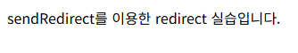 | 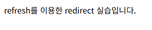 |
| **`/first3` → `/second3`** | **`/first4` → `/second4?name=lee`** |
| 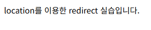 | 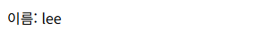 |
| **`/first5` forward, 주소 유지** | **`/first6` → `/second6`** |
| 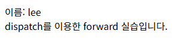 | 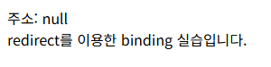 |
| **`/first7` forward, 주소 유지** | **`/member` forward, 주소 유지** |
| 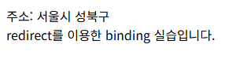 | 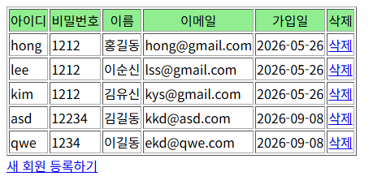 |

curl로 받은 응답. redirect 방식은 302 상태와 `Location` 헤더, `Refresh` 헤더, 이동 스크립트만 보내고, forward 방식은 첫 주소에서 바로 200 응답 본문 수신.

| sendRedirect, Refresh, location.href 응답 | forward 응답 |
|---|---|
| 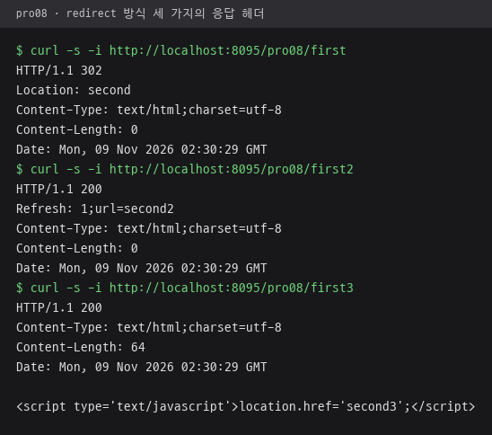 | 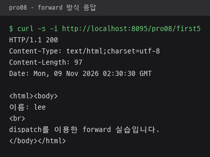 |

request 속성 전달 비교. redirect 쪽 `/first6`은 302 응답 뒤 새 요청이라 `주소: null`, forward 쪽 `/first7`은 같은 request를 이어받아 `주소: 서울시 성북구`.

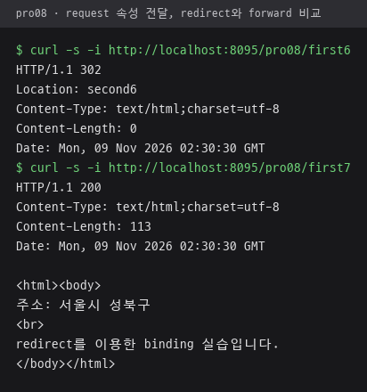

## 파일별 역할

| 파일 | 역할 | 핵심 코드 |
|---|---|---|
| [sec01/ex01/FirstServlet.java](src/main/java/sec01/ex01/FirstServlet.java) | `/first` 요청을 `second`로 redirect | `response.sendRedirect("second")` |
| [sec01/ex01/SecondServlet.java](src/main/java/sec01/ex01/SecondServlet.java) | sendRedirect 이동 안내 문구 출력 | `out.println(...)` |
| [sec01/ex02/FirstServlet.java](src/main/java/sec01/ex02/FirstServlet.java) | 1초 뒤 `second2`로 이동하는 Refresh 헤더 지정 | `response.addHeader("Refresh", "1;url=second2")` |
| [sec01/ex02/SecondServlet.java](src/main/java/sec01/ex02/SecondServlet.java) | Refresh 이동 안내 문구 출력 | `@WebServlet("/second2")` |
| [sec01/ex03/FirstServlet.java](src/main/java/sec01/ex03/FirstServlet.java) | 응답에 이동 스크립트 출력 | `out.print("location.href='second3';")` |
| [sec01/ex03/SecondServlet.java](src/main/java/sec01/ex03/SecondServlet.java) | location 이동 안내 문구 출력 | `@WebServlet("/second3")` |
| [sec02/ex01/FirstServlet.java](src/main/java/sec02/ex01/FirstServlet.java) | 이름 값을 쿼리 문자열에 붙여 redirect | `sendRedirect("second4?name=lee")` |
| [sec02/ex01/SecondServlet.java](src/main/java/sec02/ex01/SecondServlet.java) | 쿼리 문자열의 이름 출력 | `request.getParameter("name")` |
| [sec03/ex01/FirstServlet.java](src/main/java/sec03/ex01/FirstServlet.java) | 이름 값을 붙인 주소로 forward | `request.getRequestDispatcher("second5?name=lee")`, `dispatch.forward(request, response)` |
| [sec03/ex01/SecondServlet.java](src/main/java/sec03/ex01/SecondServlet.java) | forward로 받은 이름과 안내 문구 출력 | `getParameter("name")` |
| [sec04/ex01/FirstServlet.java](src/main/java/sec04/ex01/FirstServlet.java) | request 속성에 주소를 저장한 뒤 redirect | `request.setAttribute("address", "서울시 성북구")`, `sendRedirect("second6")` |
| [sec04/ex01/SecondServlet.java](src/main/java/sec04/ex01/SecondServlet.java) | request 속성 주소 출력, redirect로 넘어와 새 request에서 조회 | `(String)request.getAttribute("address")` |
| [sec04/ex02/FirstServlet.java](src/main/java/sec04/ex02/FirstServlet.java) | request 속성에 주소를 저장한 뒤 forward | `setAttribute("address", ...)`, `getRequestDispatcher("second7")` |
| [sec04/ex02/SecondServlet.java](src/main/java/sec04/ex02/SecondServlet.java) | forward로 이어진 request에서 주소 속성 출력, 안내 문구는 sec04.ex01과 같은 문장 | `getAttribute("address")` |
| [sec04/ex03/MemberServlet.java](src/main/java/sec04/ex03/MemberServlet.java) | 회원 목록을 조회해 request 속성에 담고 ViewServlet으로 forward | `request.setAttribute("membersList", membersList)`, `getRequestDispatcher("viewMembers")` |
| [sec04/ex03/ViewServlet.java](src/main/java/sec04/ex03/ViewServlet.java) | request 속성의 회원 목록을 삭제 링크가 있는 HTML 표로 출력. 삭제·등록 링크 주소는 pro07 경로 | `(List)request.getAttribute("membersList")` |
| [sec04/ex03/MemberDAO.java](src/main/java/sec04/ex03/MemberDAO.java) | JNDI 커넥션 풀 기반 회원 조회, 등록, 삭제 | `envContext.lookup("jdbc/oracle")`, `?` 바인딩 |
| [sec04/ex03/MemberVO.java](src/main/java/sec04/ex03/MemberVO.java) | 회원 VO | getter·setter |
| [web.xml](src/main/webapp/WEB-INF/web.xml) | 시작 파일 목록만 둔 설정 파일 | `<welcome-file-list>` |
