# pro09 · 쿠키와 세션

브라우저에 값을 남기는 쿠키와 서버에 값을 남기는 세션으로 요청 사이의 상태를 유지하고, DB에서 회원을 확인한 뒤 세션에 로그인 정보를 저장하는 로그인 구현.

이전 단계와 차이: pro08까지는 요청 하나가 끝나면 값이 사라졌지만, pro09는 쿠키와 세션으로 여러 요청에 걸쳐 로그인 상태 유지. 회원 확인 DAO는 pro07의 JNDI 커넥션 풀 방식 사용.

## 다룬 개념

| 개념 | 뜻과 사용 방법 |
|---|---|
| HTTP의 무상태성 | 서버가 이전 요청을 기억하지 않는 HTTP의 성질. 로그인 상태를 이어 가려면 쿠키나 세션 필요 |
| 쿠키 | 서버가 보낸 이름·값을 브라우저가 저장해 두고 같은 서버에 요청할 때마다 함께 보내는 정보. `new Cookie()`로 생성, `setMaxAge()`로 유효 기간 지정, `addCookie()`로 전송, `getCookies()`로 조회 |
| URL 인코딩 | 한글처럼 쿠키 값에 그대로 넣을 수 없는 문자를 `%` 코드로 바꾸는 변환. `URLEncoder.encode()`로 저장, `URLDecoder.decode()`로 복원 |
| 자바스크립트 쿠키 | 브라우저에서 `document.cookie`로 쿠키를 쓰고 읽는 방법. 팝업창 표시 여부 저장에 사용 |
| 세션 | 서버가 브라우저마다 만드는 저장 공간. 세션 아이디를 쿠키로 주고받아 같은 사용자 구분 |
| `HttpSession` 메소드 | `getSession()`은 세션 조회 또는 생성, `getSession(false)`는 있을 때만 조회, `isNew()`는 새 세션 여부, `setMaxInactiveInterval()`은 유효 시간 지정, `invalidate()`는 세션 삭제 |
| `encodeURL()` | 쿠키를 쓸 수 없는 브라우저에서도 세션이 이어지도록 주소 뒤에 세션 아이디를 붙이는 메소드 |
| DB 로그인 확인 | 아이디와 비밀번호가 모두 일치하는 행 수를 Oracle `decode(count(*), 1, 'true', 'false')`로 문자열 반환, `Boolean.parseBoolean()`으로 변환 |

## 요청 흐름

DB 확인 로그인 sec05.ex01 기준.

1. login3.html에서 아이디, 비밀번호 입력 후 POST로 `login5` 전송
2. `@WebServlet("/login5")` LoginServlet의 `doPost()`가 `user_id`, `user_pwd` 값을 MemberVO에 담음
3. `MemberDAO.isExisted()`가 JNDI 커넥션 풀 연결로 `where id=? and pwd=?` 조건의 `decode(count(*), ...)` 쿼리 실행
4. 일치하면 세션에 `isLogon`, `login.id`, `login.pwd`를 저장하고 환영 문구와 회원정보 보기 링크 출력. 일치하지 않으면 다시 로그인하기 링크 출력
5. 회원정보 보기 링크로 `/show` 요청 시 ShowMember가 `getSession(false)`로 세션 확인
6. 세션의 `isLogon`이 참이면 아이디와 비밀번호 출력, 세션이 없거나 로그인 상태가 아니면 `sendRedirect("login3.html")`

| 방식 | 값 저장 위치 | 사용 파일 |
|---|---|---|
| 서버에서 만든 쿠키 | 브라우저 | SetCookieValue, GetCookieValue |
| 자바스크립트 쿠키 | 브라우저 | popupTest.html, popUp.html |
| 세션 | 서버 | SessionTest, SessionTest2, SessionTest4, SessionTest5, LoginServlet, ShowMember |

## 실행 결과

Tomcat 9.0.118에 배포해 브라우저로 요청한 화면. 세션 화면은 브라우저를 새로 띄운 상태에서 요청.

세션 정보 `/sess`. 첫 요청에만 새 세션 안내 문구, 같은 브라우저로 다시 요청하면 같은 세션 아이디에 안내 문구 없음.

| 첫 요청 | 다시 요청 |
|---|---|
| 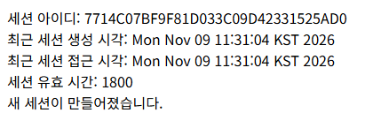 | 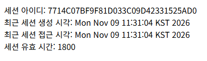 |

`/sess2`에서 기본 유효 시간 1800초를 5초로 바꾼 결과.

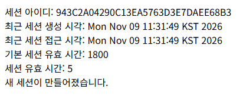

쿠키 저장과 조회.

| `/set` 쿠키 저장 | 같은 브라우저로 `/get` 쿠키 조회 |
|---|---|
| 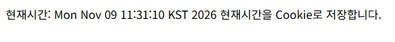 | 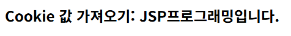 |

DB 확인 로그인 `login3.html` → `/login5` → `/show`. 로그인 없이 `/show`를 요청하면 `login3.html`로 redirect된 로그인 폼 표시.

| hong, 1212 입력 | 로그인 성공 | 회원정보 보기 |
|---|---|---|
| 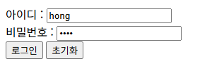 | 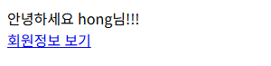 | 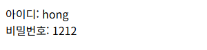 |
| **비밀번호 0000 입력 결과** | **로그인 없이 `/show` 요청** | |
| 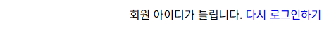 | 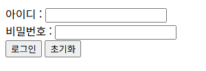 | |

세션 속성으로 아이디 유지. 첫 요청 화면의 로그인 상태 확인 링크를 눌러 다음 요청 확인. SessionTest5의 링크 주소는 `encodeURL()` 결과인 `login;jsessionid=세션아이디` 형태.

| `/sess4?user_id=hong` 첫 요청 | 링크를 눌러 `/sess4` 다시 요청 |
|---|---|
| 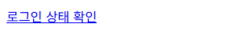 | 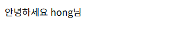 |
| **login.html에서 lee로 전송** | **링크를 눌러 `/login` 다시 요청** |
|  | 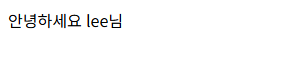 |

자바스크립트 쿠키 팝업창 `popUp.html`. 체크박스를 선택하면 `notShowPop=true` 쿠키가 저장되어 이후 popupTest.html에서 팝업창을 열지 않는 구조.

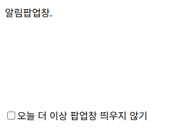

## 파일별 역할

| 파일 | 역할 | 핵심 코드 |
|---|---|---|
| [sec02/ex01/SetCookieValue.java](src/main/java/sec02/ex01/SetCookieValue.java) | `/set` 요청에 한글 문자열 `JSP프로그래밍입니다.`를 인코딩해 하루 동안 유지되는 쿠키로 저장, 화면에는 현재 시간 출력 | `new Cookie("cookieTest", URLEncoder.encode(...))`, `c.setMaxAge(24*60*60)` |
| [sec02/ex01/GetCookieValue.java](src/main/java/sec02/ex01/GetCookieValue.java) | `/get` 요청에 쿠키 목록에서 `cookieTest`를 찾아 디코딩한 값 출력 | `request.getCookies()`, `URLDecoder.decode()` |
| [sec03/ex01/SessionTest.java](src/main/java/sec03/ex01/SessionTest.java) | `/sess` 요청에 세션 아이디, 생성 시각, 마지막 접근 시각, 유효 시간 출력, 새 세션이면 안내 문구 | `session.getCreationTime()`, `session.isNew()` |
| [sec03/ex02/SessionTest2.java](src/main/java/sec03/ex02/SessionTest2.java) | 기본 유효 시간을 출력한 뒤 5초로 바꿔 다시 출력 | `session.setMaxInactiveInterval(5)` |
| [sec03/ex04/SessionTest4.java](src/main/java/sec03/ex04/SessionTest4.java) | `/sess4` 첫 요청에 아이디가 오면 세션에 저장, 다음 요청에서는 세션의 아이디로 인사, 아이디가 없으면 세션 삭제 후 로그인 링크 | `session.setAttribute("user_id", user_id)`, `session.invalidate()` |
| [sec04/ex01/SessionTest5.java](src/main/java/sec04/ex01/SessionTest5.java) | `/login` 요청을 SessionTest4와 같은 흐름으로 처리, 세션 아이디를 붙인 주소 생성 | `response.encodeURL("login")` |
| [sec05/ex01/LoginServlet.java](src/main/java/sec05/ex01/LoginServlet.java) | `/login5` POST 요청의 아이디·비밀번호를 DB로 확인하고 성공 시 세션에 로그인 정보 저장 | `dao.isExisted(memberVO)`, `session.setAttribute("isLogon", true)` |
| [sec05/ex01/MemberDAO.java](src/main/java/sec05/ex01/MemberDAO.java) | 아이디와 비밀번호가 일치하는 회원이 있는지 조회, `finally`에서 자원 해제 | `select decode(count(*), 1, 'true', 'false') as result from t_member where id=? and pwd=?` |
| [sec05/ex01/MemberVO.java](src/main/java/sec05/ex01/MemberVO.java) | 회원 VO | getter·setter |
| [sec05/ex01/ShowMember.java](src/main/java/sec05/ex01/ShowMember.java) | `/show` 요청에 로그인 세션을 확인해 회원 정보 출력, 미로그인 시 로그인 창으로 이동 | `request.getSession(false)`, `(Boolean) session.getAttribute("isLogon")` |
| [login.html](src/main/webapp/login.html) | `login`으로 POST 전송하는 로그인 폼, hidden 주소·이메일·전화번호 포함 | `type="hidden" name = "user_address"` |
| [login2.html](src/main/webapp/login2.html) | `login`으로 POST 전송하는 로그인 폼 | `action="login"` |
| [WEB-INF/login2.html](src/main/webapp/WEB-INF/login2.html) | 위 login2.html과 같은 내용의 사본 | `action="login"` |
| [login3.html](src/main/webapp/login3.html) | DB 확인 로그인용 폼, 비밀번호 입력 이름은 `user_pwd` | `action="login5"`, `name="user_pwd"` |
| [popupTest.html](src/main/webapp/popupTest.html) | 페이지를 열 때 `notShowPop` 쿠키가 `true`가 아니면 popUp.html 팝업창 열기 | `window.onload = pageLoad`, `document.cookie.split(";")`, `window.open("popUp.html", ...)` |
| [popUp.html](src/main/webapp/popUp.html) | 체크박스 선택 시 한 달 뒤 만료되는 `notShowPop=true` 쿠키를 저장하고 창 닫기 | `expireDate.setMonth(expireDate.getMonth() +1)`, `window.close()` |
| [web.xml](src/main/webapp/WEB-INF/web.xml) | 시작 파일 목록만 둔 설정 파일 | `<welcome-file-list>` |
