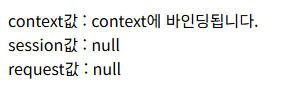
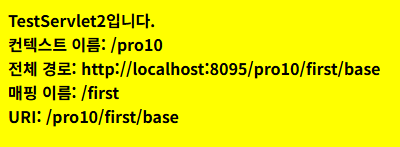
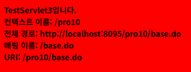
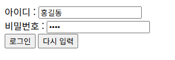

# pro10 · 서블릿 속성 범위, URL 패턴, 필터, 리스너

ServletContext, session, request에 값을 저장해 공유 범위를 비교하고, URL 패턴별 서블릿 매핑, 모든 요청에 UTF-8을 지정하는 필터, 세션 바인딩 리스너 구현.

이전 단계와 차이: pro09까지는 서블릿마다 `request.setCharacterEncoding()`을 호출했지만, pro10은 필터 한 곳에서 모든 요청의 인코딩 지정. sec03.ex01 LoginTest의 인코딩 호출은 주석 처리.

## 다룬 개념

| 개념 | 뜻과 사용 방법 |
|---|---|
| 속성 범위 | 값을 저장한 객체에 따라 공유되는 범위. ServletContext는 웹 애플리케이션 전체, HttpSession은 같은 브라우저의 요청들, request는 요청 한 번 |
| `ServletContext` | 웹 애플리케이션 하나에 하나만 있는 공용 객체. 서블릿에서 `getServletContext()`로 얻음 |
| URL 패턴 매핑 | 정확한 경로 `/first/test1`, 디렉토리 패턴 `/first/*`, 확장자 패턴 `*.do`. 주소가 여러 패턴에 맞으면 정확한 경로, 디렉토리 패턴, 확장자 패턴 순으로 선택 |
| 요청 경로 정보 | `getContextPath()`는 프로젝트 경로, `getRequestURL()`은 전체 주소, `getServletPath()`는 매핑된 경로, `getRequestURI()`는 프로젝트 경로부터 끝까지 |
| 필터 | 서블릿 실행 전에 요청을 가로채 공통 작업을 하는 객체. `Filter` 인터페이스 구현, `@WebFilter("/*")`로 모든 요청에 적용, `chain.doFilter()`로 다음 단계 진행 |
| 리스너 | 특정 사건이 생길 때 자동으로 호출되는 객체. `HttpSessionBindingListener`를 구현한 객체는 세션에 저장될 때 `valueBound()`, 세션에서 빠질 때 `valueUnbound()` 호출 |
| 정적 필드 접속자 수 | 모든 객체가 공유하는 `static int total_user`를 리스너 메소드에서 늘리고 줄여 접속자 수 관리 |

## 요청 흐름

필터를 거치는 로그인 요청 기준.

1. login.html에서 이름과 비밀번호를 POST로 `login` 전송
2. `@WebFilter("/*")` EncoderFilter의 `doFilter()`가 서블릿보다 먼저 실행되어 `request.setCharacterEncoding("utf-8")` 지정
3. 같은 필터가 컨텍스트 경로, 요청 URI, 실제 파일 경로를 콘솔 출력
4. `chain.doFilter(request, response)`로 `@WebServlet("/login")` LoginTest 실행
5. LoginTest가 `user_name`, `user_pw` 값을 받아 HTML로 출력

| 서블릿 | 매핑 | 응답 배경색 | 출력 내용 |
|---|---|---|---|
| TestServlet1 | `/first/test1` 정확한 경로 | green | 제목 문구, 경로 정보는 변수에만 저장 |
| TestServlet2 | `/first/*` 디렉토리 패턴 | yellow | 컨텍스트 이름, 전체 경로, 매핑 이름, URI |
| TestServlet3 | `*.do` 확장자 패턴, `/*` 매핑은 주석 | red | 컨텍스트 이름, 전체 경로, 매핑 이름, URI |

## 실행 결과

Tomcat 9.0.118에 배포해 브라우저로 요청한 화면.

속성 범위 `/set` → `/get`. context 값만 남고, 세션 값은 `context` 이름으로 저장해 `session` 이름 조회 결과가 null, request 값은 새 요청이라 null.

| `/set` | `/get` |
|---|---|
|  |  |

URL 패턴별 서블릿.

| `/first/test1` 정확한 경로 | `/first/base` 디렉토리 패턴 | `/base.do` 확장자 패턴 |
|---|---|---|
|  |  |  |

필터를 거친 로그인 `login.html` → `/login`. LoginTest의 인코딩 지정은 주석이지만 필터 덕분에 한글 이름 정상 출력.

| 이름 홍길동 입력 | LoginTest 응답 |
|---|---|
|  |  |

## 파일별 역할

| 파일 | 역할 | 핵심 코드 |
|---|---|---|
| [sec01/ex01/SetAttribute.java](src/main/java/sec01/ex01/SetAttribute.java) | `/set` 요청 시 ServletContext, session, request에 각각 문자열 저장. 세션에는 `context` 이름으로 저장 | `ctx.setAttribute("context", ctxMesg)`, `session.setAttribute("context", sesMesg)`, `request.setAttribute("request", reqMesg)` |
| [sec01/ex01/GetAttribute.java](src/main/java/sec01/ex01/GetAttribute.java) | `/get` 요청에 저장한 값을 다시 꺼내 출력, request 값은 새 요청이라 남지 않는 구조 | `ctx.getAttribute("context")`, `sess.getAttribute("session")`, `request.getAttribute("request")` |
| [sec02/ex01/TestServlet1.java](src/main/java/sec02/ex01/TestServlet1.java) | 정확한 경로 `/first/test1` 매핑 | `@WebServlet("/first/test1")` |
| [sec02/ex01/TestServlet2.java](src/main/java/sec02/ex01/TestServlet2.java) | `/first/` 아래 모든 주소 매핑, 요청 경로 정보 출력 | `@WebServlet("/first/*")`, `request.getServletPath()` |
| [sec02/ex01/TestServlet3.java](src/main/java/sec02/ex01/TestServlet3.java) | `.do`로 끝나는 모든 주소 매핑, 요청 경로 정보 출력 | `@WebServlet("*.do")` |
| [sec03/ex01/EncoderFilter.java](src/main/java/sec03/ex01/EncoderFilter.java) | 모든 요청에 UTF-8 인코딩 지정, 컨텍스트 경로와 실제 경로 콘솔 출력 | `implements Filter`, `@WebFilter("/*")`, `request.getRealPath(pathinfo)`, `chain.doFilter()` |
| [sec03/ex01/LoginTest.java](src/main/java/sec03/ex01/LoginTest.java) | `/login` POST 요청의 이름과 비밀번호 출력, 인코딩은 필터가 담당 | `//request.setChartacterEncoding("utf-8")`, `getParameter("user_name")` |
| [sec04/ex02/LoginImpl.java](src/main/java/sec04/ex02/LoginImpl.java) | 세션에 저장되거나 빠질 때 접속자 수를 늘리고 줄이는 리스너 클래스 | `implements HttpSessionBindingListener`, `valueBound()`, `++total_user` |
| [sec04/ex02/LoginTest2.java](src/main/java/sec04/ex02/LoginTest2.java) | `/login2` POST 요청에 새 세션이면 LoginImpl 객체를 세션에 저장해 `valueBound()` 호출. 응답은 `<script>` 시작 태그까지 작성 | `new LoginImpl(user_id, user_pw)`, `session.setAttribute("loginUser", loginUser)` |
| [login.html](src/main/webapp/login.html) | 이름 `user_name`, 비밀번호 `user_pw`를 POST로 `login` 전송 | `action="login"` |
| [login2.html](src/main/webapp/login2.html) | login.html과 같은 입력칸, 전송 주소만 `login2` | `action="login2"` |
| [web.xml](src/main/webapp/WEB-INF/web.xml) | 시작 파일 목록만 둔 설정 파일. 서블릿과 필터는 애너테이션으로 등록 | `<welcome-file-list>` |
