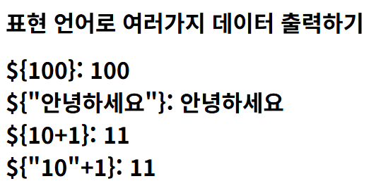
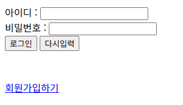
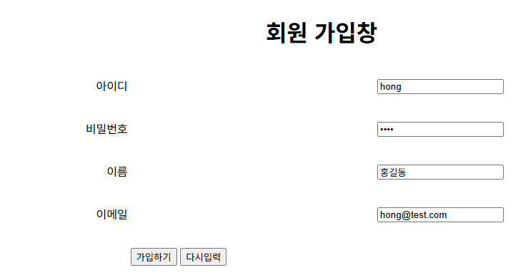
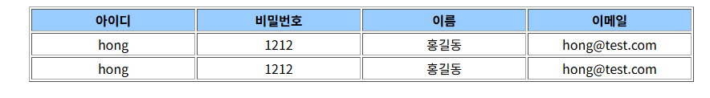
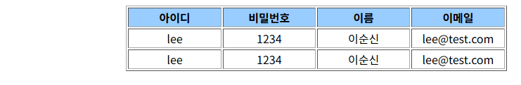
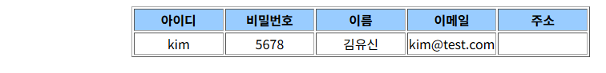

# pro14 · JSP 표현 언어와 자바빈

JSP에서 표현 언어 EL로 값을 출력하고, 회원 가입 폼 값을 자바빈 객체에 담아 forward한 화면에서 스크립틀릿 출력과 EL 출력을 나란히 비교.

이전 단계와 차이: pro10까지는 서블릿의 `PrintWriter`로 HTML을 문자열로 출력했지만, pro14는 HTML 안에 Java 코드와 EL을 넣는 JSP로 화면 작성.

## 다룬 개념

| 개념 | 뜻과 사용 방법 |
|---|---|
| JSP | HTML 안에 Java 코드를 넣어 실행 결과로 화면을 만드는 파일. 서버가 서블릿으로 변환해 실행 |
| page 지시어 | JSP 전체 설정을 적는 `<%@ page %>`. `contentType`, `pageEncoding`, `import`, EL 사용 여부 `isELIgnored="false"` |
| 스크립틀릿과 표현식 | `<% %>` 안에는 Java 문장, `<%= %>` 안에는 출력할 값 |
| 표현 언어 EL | `${ }` 안의 식을 계산해 출력하는 문법. `${10+1}`, 숫자 문자열과 숫자의 덧셈 `${"10"+1}` |
| `param` 객체 | 요청 매개변수를 EL로 꺼내는 내장 객체. `${param.id}`는 `request.getParameter("id")`와 같은 값 |
| `requestScope` 객체 | request 속성을 EL로 꺼내는 내장 객체. `${requestScope.address}` |
| `pageContext.request.contextPath` | 프로젝트 경로를 EL로 얻는 식. 링크 주소 앞에 붙여 프로젝트 이름이 바뀌어도 같은 링크 사용 |
| 자바빈 | 기본 생성자, private 필드, getter·setter를 갖춘 Java 클래스. `MemberBean` |
| `jsp:useBean`, `jsp:setProperty` | JSP에서 자바빈 객체를 만드는 태그와 값을 넣는 태그. `property="*"`는 이름이 같은 요청 매개변수를 필드에 한 번에 저장 |
| `jsp:forward` | 현재 요청을 다른 JSP로 넘기는 액션 태그 |
| JSP 주석 | 서버에서 처리되어 브라우저에 전달되지 않는 `<%-- --%>` 주석. 일부 EL 식과 링크 작성 방식을 주석으로 보관 |

## 요청 흐름

회원 가입 폼에서 결과 화면까지.

1. login.jsp의 회원가입하기 링크로 `${pageContext.request.contextPath}/test01/memberForm.jsp` 이동
2. memberForm.jsp에서 아이디, 비밀번호, 이름, 이메일 입력 후 POST로 forward.jsp 전송
3. forward.jsp가 요청 값으로 `MemberBean` 객체를 만들어 `request.setAttribute("member", member)`로 저장
4. `<jsp:forward page="member3.jsp">`로 같은 요청을 member3.jsp에 전달
5. member3.jsp가 `jsp:useBean`과 `jsp:setProperty property="*"`로 같은 요청 매개변수를 새 빈 `m`에 저장
6. 표현식 `<%=m.getId() %>` 행과 EL `${param.id}` 행으로 같은 값을 두 번 출력

## 실행 결과

Tomcat 9.0.118에 배포해 브라우저로 요청한 화면.

| `elTest1.jsp` EL 출력 | `test01/login.jsp` 로그인 폼과 회원가입 링크 |
|---|---|
|  |  |

회원 가입 폼에서 결과 화면까지. `memberForm.jsp`에서 입력한 값이 `forward.jsp`를 거쳐 `member3.jsp`에 표시되고, 주소창은 `forward.jsp` 유지. 위 행은 자바빈 getter, 아래 행은 EL `param` 출력.

`member1.jsp`, `member2.jsp`에 쿼리 문자열로 값을 넘겨 요청한 결과. `member2.jsp`의 주소 칸은 request 속성 `address`가 없어 빈 칸.

| member1.jsp | member2.jsp |
|---|---|
|  |  |

## 파일별 역할

| 파일 | 역할 | 핵심 코드 |
|---|---|---|
| [MemberBean.java](src/main/java/sec01/ex01/MemberBean.java) | 회원 정보 자바빈, 기본 생성자와 매개변수 생성자 | `public MemberBean()`, `MemberBean(String id, String pwd, String name, String email)` |
| [elTest1.jsp](src/main/webapp/elTest1.jsp) | EL 숫자·문자열·덧셈 결과를 `\${ }` 원문 표기와 나란히 출력 | `\${100}: ${100}`, `${"10"+1}`, `isELIgnored="false"` |
| [test01/login.jsp](src/main/webapp/test01/login.jsp) | 로그인 폼과 회원가입 링크. 링크 주소의 절대 주소 방식과 표현식 방식은 주석으로 보관하고 EL 방식 사용 | `${pageContext.request.contextPath}/test01/memberForm.jsp` |
| [test01/memberForm.jsp](src/main/webapp/test01/memberForm.jsp) | 아이디, 비밀번호, 이름, 이메일 입력 폼, POST로 forward.jsp 전송 | `<form method="post" action="forward.jsp">` |
| [test01/forward.jsp](src/main/webapp/test01/forward.jsp) | 요청 값으로 MemberBean을 만들어 request 속성에 저장하고 member3.jsp로 forward | `request.setAttribute("member", member)`, `<jsp:forward page="member3.jsp">` |
| [test01/member1.jsp](src/main/webapp/test01/member1.jsp) | 스크립틀릿 변수 출력 행과 EL `param` 출력 행으로 같은 값 비교 | `<%=id %>`, `${param.id }` |
| [test01/member2.jsp](src/main/webapp/test01/member2.jsp) | EL `param` 값과 request 속성 주소를 함께 출력하는 표 | `${param.email }`, `${requestScope.address }` |
| [test01/member3.jsp](src/main/webapp/test01/member3.jsp) | 자바빈 태그로 요청 값을 빈에 저장하고 getter 출력과 EL 출력 비교 | `<jsp:useBean id="m" class="sec01.ex01.MemberBean" />`, `<jsp:setProperty name="m" property="*" />` |
| [web.xml](src/main/webapp/WEB-INF/web.xml) | 시작 파일 목록만 둔 설정 파일 | `<welcome-file-list>` |
