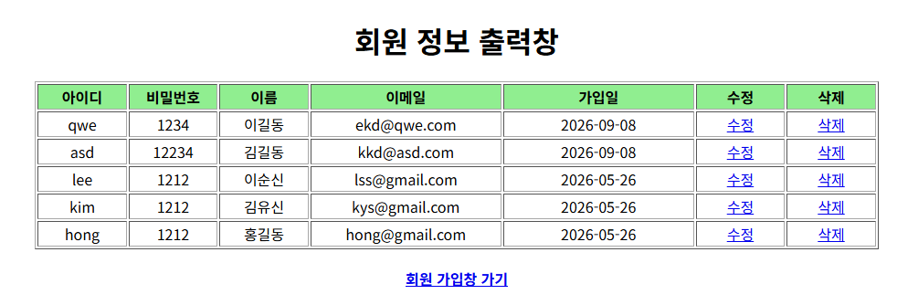
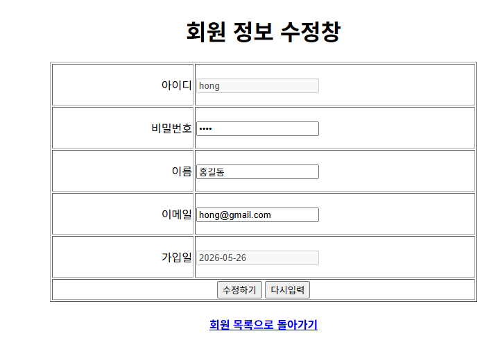
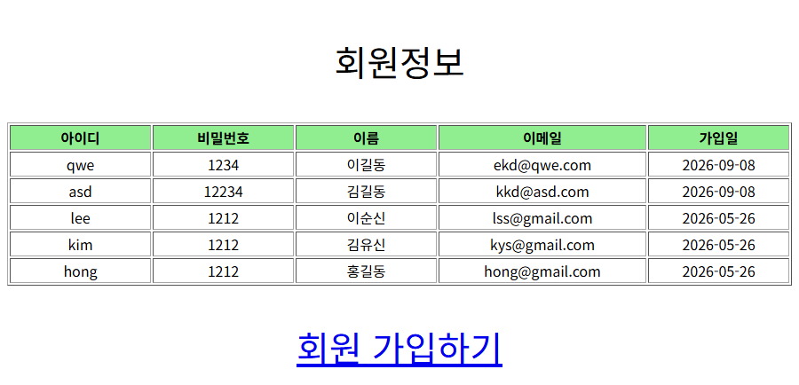
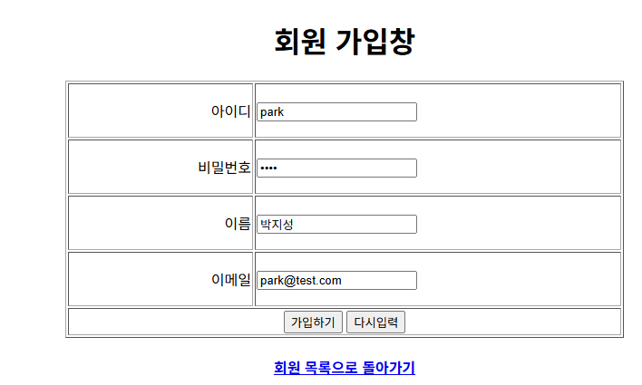

# pro17 · MVC 패턴 회원 관리

컨트롤러 서블릿이 요청 주소로 기능을 나누고, DAO가 DB를 처리하고, JSP가 JSTL로 화면을 그리는 MVC 구조의 회원 목록·등록·수정·삭제 구현.

이전 단계와 차이: pro08은 서블릿이 HTML 문자열로 회원 목록을 출력했지만, pro17은 서블릿이 데이터만 request 속성에 담아 JSP로 forward하고 JSP가 JSTL `c:forEach`로 표 출력. DAO에 회원 한 명 조회 `findMember()`와 수정 `modMember()` 추가.

## 다룬 개념

| 개념 | 뜻과 사용 방법 |
|---|---|
| MVC 패턴 | 프로그램을 Model, View, Controller로 나누는 구조. Model은 데이터와 DB 처리, View는 화면, Controller는 요청을 받아 Model과 View 연결 |
| 컨트롤러 서블릿 | 여러 기능의 요청을 서블릿 하나가 받아 분기하는 구조. `@WebServlet("*.do")`로 `.do`로 끝나는 모든 요청 수신 |
| `getServletPath()` 분기 | 요청 주소에서 프로젝트 경로 뒤 부분을 꺼내 `/listMembers.do`, `/addMember.do` 같은 값으로 처리할 기능 결정 |
| JSTL | JSP에서 조건과 반복을 태그로 쓰는 표준 태그 라이브러리. `<%@ taglib prefix="c" uri="http://java.sun.com/jsp/jstl/core" %>`로 선언 |
| `c:forEach`, `c:choose`, `c:set` | 목록 반복 출력, 조건별 분기, 변수 지정 태그. `c:set`으로 `contextPath` 변수를 만들어 링크 주소에 사용 |
| EL `empty` 연산자 | 값이 `null`이거나 비어 있는지 검사. `${empty membersList}` |
| 처리 결과 메시지 | 수정·삭제 뒤 `request.setAttribute("msg", "modified")`를 담아 목록 요청으로 forward, 목록 JSP가 `msg` 값에 따라 `alert()` 표시 |
| redirect와 forward 선택 | 등록 뒤에는 `sendRedirect()`로 목록 주소를 새로 요청하고, 수정·삭제 뒤에는 메시지를 유지하려고 forward로 목록 요청 |
| 생성자 오버로딩 VO | 아이디·비밀번호·이름·이메일을 받는 등록용 생성자와 가입일까지 받는 조회용 생성자를 함께 둔 `MemberVO` |

## 요청 흐름

sec02.ex02 회원 정보 수정 기준.

1. 브라우저가 `/pro17/listMembers.do` 요청
2. `*.do`에 매핑된 MemberController가 `getServletPath()`로 `/listMembers.do` 확인
3. `memberDAO.listMembers()`가 가입일 역순 목록을 조회하고, 컨트롤러가 `membersList` 속성에 저장
4. `/test03/listMembers.jsp`로 forward, `c:forEach`가 행마다 수정·삭제 링크 출력
5. 수정 링크 `/modMemberForm.do?id=` 요청 시 `findMember(id)` 결과를 `memInfo` 속성에 담아 modMemberForm.jsp 표시
6. 수정하기를 누르면 POST로 `/modMember.do?id=` 전송, `modMember()`가 `update t_member set pwd=?,name=?,email=? where id=?` 실행
7. 컨트롤러가 `msg=modified`를 담아 `/listMembers.do`로 forward, 목록 화면이 다시 조회되고 수정 알림 표시

| 요청 주소 | 처리 | 다음 화면 |
|---|---|---|
| `/listMembers.do` | 회원 목록 조회 | test03/listMembers.jsp |
| `/addMember.do` | 회원 등록 | `sendRedirect`로 `/listMembers.do` |
| `/memberForm.do` | 가입 폼 이동 | test03/memberForm.jsp |
| `/modMemberForm.do` | 회원 한 명 조회 | test03/modMemberForm.jsp |
| `/modMember.do` | 회원 정보 수정, `msg=modified` | forward로 `/listMembers.do` |
| `/delMember.do` | 회원 삭제, `msg=deleted` | forward로 `/listMembers.do` |

## 실행 결과

Tomcat 9.0.118에 배포해 브라우저로 요청한 화면. 로컬 Oracle `t_member` 테이블 조회 결과이며, 수정·삭제·등록 요청은 DB 내용을 바꾸므로 캡처 대상에서 제외.

`/listMembers.do` 회원 목록. 가입일 역순 정렬과 행마다 수정·삭제 링크.

| `/modMemberForm.do?id=hong` 수정 폼 | `/MemberController` sec01 목록 |
|---|---|
|  |  |

목록 화면의 회원 가입창 가기 링크로 연 `/memberForm.do` 가입 폼. 가입하기를 누르면 `/addMember.do`로 전송.

## 파일별 역할

| 파일 | 역할 | 핵심 코드 |
|---|---|---|
| [sec01/ex01/MemberController.java](src/main/java/sec01/ex01/MemberController.java) | `/MemberController` 요청에 회원 목록을 조회해 test01/listMembers.jsp로 forward하는 단일 기능 컨트롤러 | `init()`에서 `new MemberDAO()`, `request.setAttribute("membersList", membersList)` |
| [sec01/ex01/MemberDAO.java](src/main/java/sec01/ex01/MemberDAO.java) | JNDI 커넥션 풀 연결로 가입일 역순 회원 목록 조회 | `select * from t_member order by joinDate desc` |
| [sec01/ex01/MemberVO.java](src/main/java/sec01/ex01/MemberVO.java) | 회원 VO, 기본 생성자와 아이디·비밀번호·이름·이메일 생성자 | `MemberVO(String id, String pwd, String name, String email)` |
| [sec02/ex02/MemberController.java](src/main/java/sec02/ex02/MemberController.java) | `*.do` 요청을 `getServletPath()` 값으로 목록, 등록, 가입 폼, 수정 폼, 수정, 삭제로 분기 | `@WebServlet("*.do")`, `action.equals("/modMember.do")`, `dispatch.forward(request, response)` |
| [sec02/ex02/MemberDAO.java](src/main/java/sec02/ex02/MemberDAO.java) | 목록 조회, 등록, 한 명 조회, 수정, 삭제. `finally`에서 연결 자원 해제 | `findMember(String _id)`, `modMember(MemberVO memberVO)`, `delete from t_member where id=?` |
| [sec02/ex02/MemberVO.java](src/main/java/sec02/ex02/MemberVO.java) | 등록용 생성자와 가입일 포함 조회용 생성자를 둔 회원 VO | `MemberVO(String id, String pwd, String name, String email, Date joinDate)` |
| [sec03/brd01/ArticleVO.java](src/main/java/sec03/brd01/ArticleVO.java) | 게시글 VO. 계층 수준, 글 번호, 부모 글 번호, 제목, 내용, 이미지 파일 이름, 작성자, 작성일 필드와 생성자만 정의 | `private int parentNO`, `private String imageFileName` |
| [test01/listMembers.jsp](src/main/webapp/test01/listMembers.jsp) | 회원 목록이 비었으면 안내 문구, 있으면 JSTL 반복으로 표 출력 | `<c:when test="${empty membersList}">`, `<c:forEach var="mem" items="${membersList}">` |
| [test03/listMembers.jsp](src/main/webapp/test03/listMembers.jsp) | `msg` 값에 따라 등록·수정·삭제 알림, 행마다 수정·삭제 링크와 가입 링크 | `<c:when test="${msg=='modified'}">`, `${contextPath}/modMemberForm.do?id=${mem.id}` |
| [test03/memberForm.jsp](src/main/webapp/test03/memberForm.jsp) | 아이디, 비밀번호, 이름, 이메일 입력 폼, POST로 `/addMember.do` 전송 | `action="${contextPath}/addMember.do"`, `name="id"` |
| [test03/modMemberForm.jsp](src/main/webapp/test03/modMemberForm.jsp) | 조회한 회원 값을 채운 수정 폼, 아이디와 가입일은 비활성 입력칸 | `value="${memInfo.pwd}"`, `disabled`, `action="${contextPath}/modMember.do?id=${memInfo.id}"` |
| [web.xml](src/main/webapp/WEB-INF/web.xml) | 시작 파일 목록만 둔 설정 파일 | `<welcome-file-list>` |
