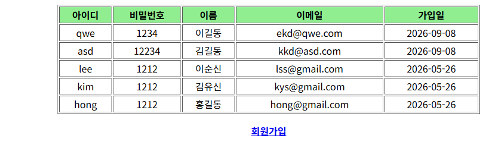
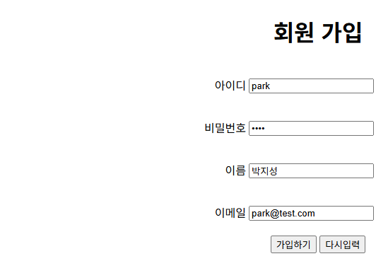

# pro22 · Spring JDBC와 계층 분리

Controller·Service·DAO를 인터페이스와 구현 클래스로 나누고 XML setter 주입으로 연결한 회원 목록·가입 기능. DAO는 Spring `JdbcTemplate`으로 Oracle 조회·등록 실행.

이전 단계와 차이: pro21은 컨트롤러가 요청 값을 그대로 뷰에 넘겼지만, pro22는 Service와 DAO 계층을 더해 DB까지 연결. 빈 설정도 `ContextLoaderListener`가 읽는 `config/action-service.xml`, `config/action-dataSource.xml`로 분리.

## 다룬 개념

| 개념 | 뜻과 사용 방법 |
|---|---|
| 계층 분리 | Controller는 요청과 응답, Service는 업무 처리, DAO는 DB 접근을 맡도록 나눈 구조. 계층마다 인터페이스와 `Impl` 구현 클래스 작성 |
| 빈 | Spring이 만들고 관리하는 객체. XML의 `<bean id="..." class="...">`로 등록 |
| 의존성 주입 | 객체가 사용할 다른 객체를 스스로 만들지 않고 외부에서 넣어 받는 방식 |
| setter 주입 | `<property name="memberService" ref="memberService" />` 설정에 따라 Spring이 `setMemberService()`를 호출해 빈 연결 |
| `ContextLoaderListener` | 웹 애플리케이션이 시작될 때 `contextConfigLocation`에 적은 XML 파일을 읽어 공통 빈을 만드는 리스너 |
| `PropertyPlaceholderConfigurer` | 속성 파일의 값을 XML의 `${jdbc.url}` 같은 자리에 채우는 빈 |
| `DataSource` | DB 연결을 만들어 주는 객체. `SimpleDriverDataSource`에 드라이버, URL, 계정 값 지정 |
| `JdbcTemplate` | 연결 열기·닫기와 예외 변환을 맡는 Spring JDBC 도구. `query()`로 조회, `update()`로 등록 |
| `RowMapper` | `ResultSet` 한 행을 VO 객체로 바꾸는 규칙. 익명 클래스로 `mapRow()` 구현 |
| `redirect:` 접두어 | 뷰 이름 앞에 붙이면 JSP를 찾지 않고 그 주소로 redirect. 가입 뒤 `redirect:/member/listMembers.do` |

## 요청 흐름

회원 가입 기준.

1. 목록 화면의 회원가입 링크로 `/pro22/member/memberForm.do` 요청, `memberForm()`이 뷰 이름 `memberForm` 반환
2. `/WEB-INF/views/memberForm.jsp`에서 회원 정보를 POST로 `/member/addMember.do` 전송
3. DispatcherServlet이 `urlMapping`의 `/member/*.do` 규칙으로 memberController를 찾고, `methodResolver`로 `addMember()` 호출
4. 컨트롤러가 요청 값으로 MemberVO를 만들어 `memberService.addMember()` 호출
5. MemberServiceImpl이 `memberDAO.addMember()` 호출, DAO가 `jdbcTemplate.update()`로 insert 실행
6. `redirect:/member/listMembers.do`로 목록 재요청, `listMembers()`가 `selectAllMembers()` 결과를 `membersList`에 담아 listMembers.jsp 표시

| 빈 id | 클래스 | 주입받는 값 | 설정 파일 |
|---|---|---|---|
| viewResolver | `InternalResourceViewResolver` | `prefix` `/WEB-INF/views/`, `suffix` `.jsp` | config/action-service.xml |
| urlMapping | `SimpleUrlHandlerMapping` | `/member/*.do`에 memberController | config/action-service.xml |
| methodResolver | `PropertiesMethodNameResolver` | URL별 메소드 이름 | config/action-service.xml |
| memberController | MemberControllerImpl | methodResolver, memberService | config/action-service.xml |
| memberService | MemberServiceImpl | memberDAO | config/action-service.xml |
| memberDAO | MemberDAOImpl | dataSource | config/action-dataSource.xml |
| dataSource | `SimpleDriverDataSource` | jdbc.properties 값 | config/action-dataSource.xml |

## 실행 결과

Tomcat 9.0.118에 배포해 브라우저로 요청한 화면. Spring 4.1.1 jar와 로컬 Oracle `t_member` 테이블로 실행. 가입하기 전송은 DB에 행을 추가하므로 입력 화면까지만 확인.

| `/member/listMembers.do` 회원 목록 | 회원가입 링크로 연 `/member/memberForm.do` |
|---|---|
|  |  |

## 파일별 역할

| 파일 | 역할 | 핵심 코드 |
|---|---|---|
| [MemberController.java](src/main/java/com/spring/member/controller/MemberController.java) | 컨트롤러 인터페이스, 목록·가입 폼·가입·상세 메소드 선언 | `ModelAndView listMembers(...)` |
| [MemberControllerImpl.java](src/main/java/com/spring/member/controller/MemberControllerImpl.java) | 요청별 처리와 뷰 이름 추출. 뷰 이름은 마지막 `/` 뒤부터 잘라 `listMembers` 형태로 반환 | `extends MultiActionController implements MemberController`, `setMemberService()`, `new ModelAndView("redirect:/member/listMembers.do")` |
| [MemberService.java](src/main/java/com/spring/member/service/MemberService.java) | 서비스 인터페이스, 목록 조회와 가입 메소드 선언 | `List listMembers()`, `int addMember(MemberVO memberVO)` |
| [MemberServiceImpl.java](src/main/java/com/spring/member/service/MemberServiceImpl.java) | 주입받은 DAO에 조회와 등록을 위임 | `setMemberDAO(MemberDAO memberDAO)` |
| [MemberDAO.java](src/main/java/com/spring/member/dao/MemberDAO.java) | DAO 인터페이스, 전체 조회와 등록 메소드 선언 | `List selectAllMembers() throws DataAccessException` |
| [MemberDAOImpl.java](src/main/java/com/spring/member/dao/MemberDAOImpl.java) | 주입받은 DataSource로 JdbcTemplate을 만들어 조회와 등록 실행. 등록은 입력값을 따옴표와 함께 이어 붙인 insert 문 사용 | `new JdbcTemplate(dataSource)`, `jdbcTemplate.query(query, new RowMapper() {...})`, `jdbcTemplate.update(query)` |
| [MemberVO.java](src/main/java/com/spring/member/vo/MemberVO.java) | 회원 VO, 기본 생성자와 아이디·비밀번호·이름·이메일 생성자 | `MemberVO(String id, String pwd, String name, String email)` |
| [action-servlet.xml](src/main/webapp/WEB-INF/action-servlet.xml) | DispatcherServlet용 설정 파일. 빈 정의 없이 실제 설정 위치를 적은 주석만 존재 | `<beans>` |
| [config/action-service.xml](src/main/webapp/WEB-INF/config/action-service.xml) | 뷰 리졸버, URL 매핑, 메소드 이름 매핑, 컨트롤러, 서비스 빈 등록 | `<prop key="/member/addMember.do">addMember</prop>`, `<property name="memberService" ref="memberService" />` |
| [config/action-dataSource.xml](src/main/webapp/WEB-INF/config/action-dataSource.xml) | 속성 파일 로딩, DataSource 빈, DAO 빈 등록 | `PropertyPlaceholderConfigurer`, `${jdbc.driverClassName}`, `<property name="dataSource" ref="dataSource" />` |
| [config/jdbc.properties](src/main/webapp/WEB-INF/config/jdbc.properties) | 드라이버 클래스, 접속 URL, 계정 값을 담은 속성 파일 | `jdbc.driverClassName`, `jdbc.url` |
| [views/listMembers.jsp](src/main/webapp/WEB-INF/views/listMembers.jsp) | `membersList`를 JSTL 반복으로 표 출력, 회원가입 링크 | `<c:forEach var="member" items="${membersList}">` |
| [views/memberForm.jsp](src/main/webapp/WEB-INF/views/memberForm.jsp) | 회원 가입 폼, POST로 `/member/addMember.do` 전송 | `action="${pageContext.request.contextPath}/member/addMember.do"` |
| [web.xml](src/main/webapp/WEB-INF/web.xml) | `ContextLoaderListener`와 설정 파일 위치, DispatcherServlet `*.do` 매핑 | `<listener-class>...ContextLoaderListener</listener-class>`, `<param-name>contextConfigLocation</param-name>` |

`/WEB-INF/views/` 아래 JSP는 브라우저 주소로 바로 열리지 않고 컨트롤러가 반환한 뷰 이름으로만 표시.
