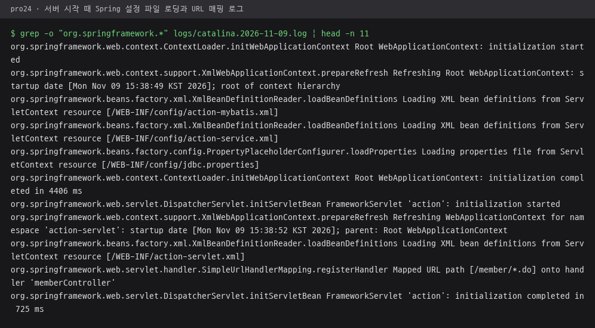
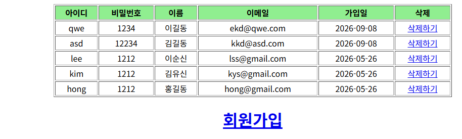
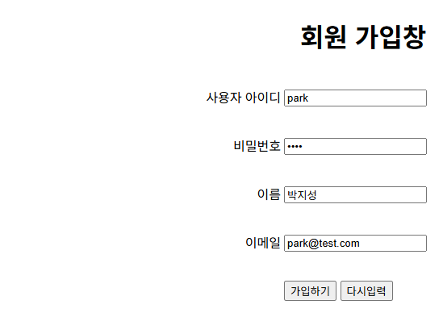
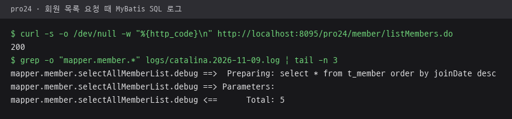

# pro24 · Spring과 MyBatis 연동

pro22의 Controller·Service·DAO 계층 구조에 MyBatis를 연결해, Spring이 만든 `SqlSessionTemplate`으로 회원 목록·가입·삭제를 실행하는 회원 관리.

이전 단계와 차이: pro22의 DAO는 `JdbcTemplate`에 SQL 문자열을 넘겼고 pro23의 DAO는 `SqlSessionFactoryBuilder`로 MyBatis를 준비했지만, pro24는 `action-mybatis.xml`에서 Spring이 `SqlSessionFactoryBean`과 `SqlSessionTemplate`을 빈으로 만들고 DAO에 setter로 주입.

## 다룬 개념

| 개념 | 뜻과 사용 방법 |
|---|---|
| `SqlSessionFactoryBean` | MyBatis-Spring 라이브러리의 빈. `dataSource`, MyBatis 설정 파일 `configLocation`, 매퍼 위치 `mapperLocations`를 받아 SqlSessionFactory 생성 |
| `SqlSessionTemplate` | Spring이 관리하는 `SqlSession` 구현. 세션 열기와 닫기를 Spring이 맡아 DAO는 `selectList()`, `insert()`, `delete()`만 호출 |
| 매퍼 위치 패턴 | `classpath:mybatis/mappers/*.xml`로 폴더 안의 매퍼 파일을 한꺼번에 등록 |
| `modelConfig.xml` | DB 연결 정보 없이 타입 별칭만 둔 MyBatis 설정 파일. DB 연결은 Spring의 `dataSource` 빈이 담당 |
| `PooledDataSource` | MyBatis가 제공하는 커넥션 풀 DataSource. `jdbc.properties` 값으로 드라이버, URL, 계정 지정 |
| `bind()` | MultiActionController가 제공하는 메소드. 요청 매개변수를 이름이 같은 VO 필드에 한 번에 저장 |
| setter 주입 | XML `<property>` 설정으로 컨트롤러에 서비스를, 서비스에 DAO를, DAO에 `sqlSession` 빈을 넣는 연결 방식 |
| `redirect:` 뷰 이름 | 가입·삭제 뒤 `redirect:/member/listMembers.do`로 목록 재요청 |

## 요청 흐름

회원 삭제 기준.

1. listMembers.jsp의 삭제하기 링크로 `/pro24/member/removeMember.do?id=` 요청
2. DispatcherServlet이 `memberUrlMapping`의 `/member/*.do` 규칙으로 memberController를 찾고, `memberMethodNameResolver`가 `removeMember` 메소드 지정
3. `removeMember()`가 `memberService.removeMember(id)` 호출, 서비스가 `memberDAO.deleteMember(id)` 호출
4. MemberDAOImpl이 주입받은 SqlSessionTemplate으로 `sqlSession.delete("mapper.member.deleteMember", id)` 실행
5. `redirect:/member/listMembers.do`로 목록을 다시 요청하고, `/WEB-INF/views/member/listMembers.jsp`에 결과 표시

| 설정 파일 | 등록한 빈 | 읽는 주체 |
|---|---|---|
| WEB-INF/action-servlet.xml | viewResolver, memberController, memberMethodNameResolver, memberUrlMapping | DispatcherServlet |
| config/action-mybatis.xml | propertyPlaceholderConfigurer, dataSource, sqlSessionFactory, sqlSession, memberDAO | ContextLoaderListener |
| config/action-service.xml | memberService | ContextLoaderListener |

서버 시작 때 Tomcat 로그. `ContextLoaderListener`가 `config/action-mybatis.xml`, `config/action-service.xml`과 `jdbc.properties`를 읽은 뒤, DispatcherServlet이 `action-servlet.xml`을 읽어 `/member/*.do`를 memberController에 매핑하는 순서.

## 실행 결과

Tomcat 9.0.118에 배포해 브라우저로 요청한 화면. Spring 4.1.1, MyBatis 3.4.6, MyBatis-Spring 1.3.2 jar와 로컬 Oracle `t_member` 테이블로 실행. 가입과 삭제는 DB 내용을 바꾸므로 목록과 입력 화면까지만 확인.

| `/member/listMembers.do` 회원 목록 | `/member/memberForm.do` 입력 화면 |
|---|---|
|  |  |

회원 목록 요청 때 SqlSessionTemplate이 매퍼 id `mapper.member.selectAllMemberList`로 실행한 SQL과 조회 행 수. 실행용 Tomcat의 `logging.properties`에서 `mapper.member` 로그 수준을 FINE으로 올려 확인한 MyBatis 로그.

## 파일별 역할

| 파일 | 역할 | 핵심 코드 |
|---|---|---|
| [MemberController.java](src/main/java/com/spring/member/controller/MemberController.java) | 컨트롤러 인터페이스, 목록·가입·삭제·폼 메소드 선언 | `ModelAndView removeMember(...)` |
| [MemberControllerImpl.java](src/main/java/com/spring/member/controller/MemberControllerImpl.java) | 목록 조회, `bind()`로 VO를 채운 가입, 삭제, 폼 이동 처리와 뷰 이름 추출 | `bind(request, memberVO)`, `memberService.removeMember(id)`, `new ModelAndView("redirect:/member/listMembers.do")` |
| [MemberService.java](src/main/java/com/spring/member/service/MemberService.java) | 서비스 인터페이스, 목록·가입·삭제 메소드 선언 | `int removeMember(String id)` |
| [MemberServiceImpl.java](src/main/java/com/spring/member/service/MemberServiceImpl.java) | 주입받은 DAO에 조회, 등록, 삭제 위임 | `setMemberDAO(MemberDAO memberDAO)` |
| [MemberDAO.java](src/main/java/com/spring/member/dao/MemberDAO.java) | DAO 인터페이스, 전체 조회·삽입·삭제 메소드 선언 | `int deleteMember(String id)` |
| [MemberDAOImpl.java](src/main/java/com/spring/member/dao/MemberDAOImpl.java) | 주입받은 SqlSession으로 매퍼 id를 호출해 조회, 삽입, 삭제 | `setSqlSession(SqlSession sqlSession)`, `sqlSession.selectList("mapper.member.selectAllMemberList")` |
| [MemberVO.java](src/main/java/com/spring/member/vo/MemberVO.java) | 회원 VO, pro22와 같은 구성 | `MemberVO(String id, String pwd, String name, String email)` |
| [mybatis/mappers/member.xml](src/main/java/mybatis/mappers/member.xml) | pro23과 같은 매퍼 파일, 이 단계에서 호출하는 id는 selectAllMemberList, insertMember, deleteMember | `<mapper namespace="mapper.member">` |
| [mybatis/model/modelConfig.xml](src/main/java/mybatis/model/modelConfig.xml) | VO 타입 별칭만 둔 MyBatis 설정 | `<typeAlias type="com.spring.member.vo.MemberVO" alias="memberVO" />` |
| [action-servlet.xml](src/main/webapp/WEB-INF/action-servlet.xml) | 뷰 리졸버, 컨트롤러, 메소드 이름 매핑, URL 매핑 빈 등록 | `<property name="prefix" value="/WEB-INF/views/member/" />`, `<prop key="/member/memberForm.do">form</prop>` |
| [config/action-mybatis.xml](src/main/webapp/WEB-INF/config/action-mybatis.xml) | 속성 파일 로딩, MyBatis 커넥션 풀, SqlSessionFactoryBean, SqlSessionTemplate, DAO 빈 등록 | `org.mybatis.spring.SqlSessionFactoryBean`, `classpath:mybatis/mappers/*.xml`, `<constructor-arg index="0" ref="sqlSessionFactory">` |
| [config/action-service.xml](src/main/webapp/WEB-INF/config/action-service.xml) | 서비스 빈 등록과 DAO 주입 | `<property name="memberDAO" ref="memberDAO" />` |
| [config/jdbc.properties](src/main/webapp/WEB-INF/config/jdbc.properties) | 드라이버 클래스, 접속 URL, 계정 값을 담은 속성 파일 | `jdbc.url` |
| [views/member/listMembers.jsp](src/main/webapp/WEB-INF/views/member/listMembers.jsp) | 회원 목록 표, 행마다 삭제하기 링크와 회원가입 링크 | `${contextPath}/member/removeMember.do?id=${member.id}` |
| [views/member/memberForm.jsp](src/main/webapp/WEB-INF/views/member/memberForm.jsp) | 회원 가입 폼, POST로 `/member/addMember.do` 전송 | `action="${contextPath}/member/addMember.do"` |
| [views/member/modMember.jsp](src/main/webapp/WEB-INF/views/member/modMember.jsp) | 회원 정보 수정 화면 틀, 전송 주소는 memberForm.jsp와 같은 `/member/addMember.do` | `action="${contextPath}/member/addMember.do"` |
| [web.xml](src/main/webapp/WEB-INF/web.xml) | ContextLoaderListener가 읽을 action-mybatis.xml과 action-service.xml 지정, DispatcherServlet `*.do` 매핑 | `/WEB-INF/config/action-mybatis.xml`, `/WEB-INF/config/action-service.xml` |
