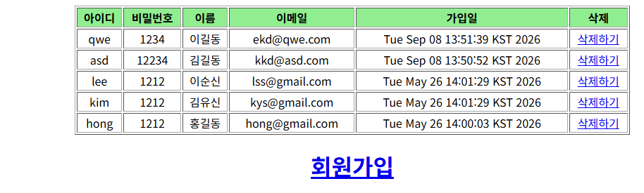
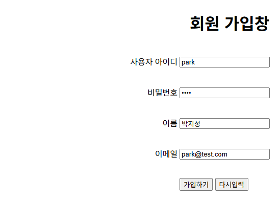
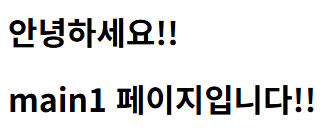
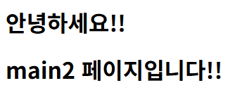
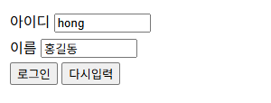
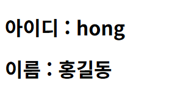
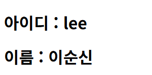
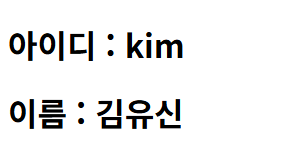
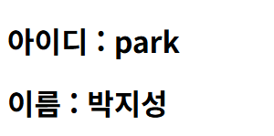

# pro26 · 애너테이션 기반 Spring MVC

XML의 URL 매핑과 setter 주입을 `@Controller`, `@RequestMapping`, `@Autowired` 애너테이션으로 바꾼 회원 관리. 요청 값을 받는 방식별 차이를 로그인 예제로 비교.

이전 단계와 차이: pro24는 `SimpleUrlHandlerMapping`, `PropertiesMethodNameResolver`, `<property>` 주입을 XML에 적었지만, pro26은 클래스와 메소드에 붙인 애너테이션과 `component-scan`으로 같은 연결 구성. `web.xml`에 Spring `CharacterEncodingFilter` 추가.

## 다룬 개념

| 개념 | 뜻과 사용 방법 |
|---|---|
| `@Controller` | 요청을 처리하는 컨트롤러 빈임을 알리는 애너테이션. `@Controller("memberController")` |
| `@RequestMapping` | 요청 URL과 HTTP 방식을 메소드에 연결하는 애너테이션. 클래스에 붙이면 공통 경로, 메소드에 붙이면 세부 경로. `value`에 배열로 여러 주소, `/member/*Form.do` 같은 패턴 지정 |
| `@RequestParam` | 요청 매개변수를 메소드 매개변수로 받는 애너테이션. `required = false`면 값이 없을 때 `null`, `Map<String, String>`으로 받으면 모든 매개변수 수신 |
| `@ModelAttribute` | 요청 매개변수를 이름이 같은 VO 필드에 담아 매개변수로 받고, 지정한 이름으로 뷰에도 전달하는 애너테이션 |
| `Model` | 뷰에 넘길 값을 담는 객체. `ModelAndView` 대신 쓰면 메소드는 뷰 이름 문자열만 반환 |
| `@Autowired` | 타입이 맞는 빈을 Spring이 찾아 필드에 넣는 애너테이션. setter 메소드 없이 주입 |
| `@Service`, `@Repository`, `@Component` | 서비스, DAO, 일반 클래스를 빈으로 등록하는 애너테이션 |
| `component-scan` | 지정한 패키지 아래에서 애너테이션이 붙은 클래스를 찾아 빈으로 등록하는 설정. `base-package="com.spring"` |
| 애너테이션 처리 빈 | `DefaultAnnotationHandlerMapping`은 `@RequestMapping` 정보로 처리 메소드를 찾고, `AnnotationMethodHandlerAdapter`는 그 메소드를 실행 |
| `@Transactional` | 메소드 실행을 하나의 트랜잭션으로 묶도록 선언하는 애너테이션. MemberServiceImpl 클래스에 `propagation = Propagation.REQUIRED`로 지정 |
| `CharacterEncodingFilter` | 모든 요청의 문자 인코딩을 지정하는 Spring 필터. pro10에서 만든 인코딩 필터와 같은 역할을 `web.xml` 설정으로 적용 |

## 요청 흐름

`@RequestParam` 로그인 기준.

1. `/pro26/test/loginForm.do`를 GET으로 요청, `loginForm()`이 뷰 이름 `test/loginForm` 반환
2. 뷰 리졸버가 `/WEB-INF/views/` + `test/loginForm` + `.jsp` 경로의 로그인 폼 표시
3. 폼이 `userID`, `userName`과 hidden `email`을 POST로 `/test/login2.do` 전송
4. `CharacterEncodingFilter`가 UTF-8을 지정한 뒤 DispatcherServlet에 전달
5. `DefaultAnnotationHandlerMapping`이 `@RequestMapping(value = "/test/login2.do")`가 붙은 `login2()` 선택
6. `@RequestParam`으로 받은 값을 `ModelAndView`에 담고 `test/result` 뷰 지정, result.jsp가 `${userID}`, `${userName}` 출력

| 요청 주소 | 메소드 | 값을 받는 방식 |
|---|---|---|
| `/test/login.do` | `login()` | `request.getParameter()` |
| `/test/login2.do` | `login2()` | `@RequestParam` 개별 값, `email`은 `required = false` |
| `/test/login3.do` | `login3()` | `@RequestParam Map<String, String> info` |
| `/test/login4.do` | `login4()` | `@ModelAttribute("info") LoginVO loginVO` |
| `/test/login5.do` | `login5()` | 요청 값 대신 `Model`에 고정값 저장 후 뷰 이름 문자열 반환 |

| 회원 요청 주소 | HTTP 방식 | 처리 |
|---|---|---|
| `/member/listMembers.do` | GET | 목록 조회 후 `member/listMembers` 뷰 |
| `/member/addMember.do` | POST | `@ModelAttribute("member") MemberVO`로 받은 값 등록 후 목록으로 redirect |
| `/member/removeMember.do` | GET | `@RequestParam("id")`로 받은 아이디 삭제 후 목록으로 redirect |
| `/member/*Form.do` | GET | 요청 주소에서 뷰 이름을 만들어 폼 화면 표시 |

## 실행 결과

Tomcat 9.0.118에 배포해 브라우저로 요청한 화면. Spring 4.1.1, MyBatis 3.4.6, MyBatis-Spring 1.3.2 jar로 실행. 가입과 삭제는 DB 내용을 바꾸므로 목록과 입력 화면까지만 확인.

| `/member/listMembers.do` 회원 목록 | `/member/memberForm.do` 입력 화면 |
|---|---|
|  |  |

클래스 공통 경로 `/test` 아래 두 주소를 같은 뷰로 연결한 MainController 결과.

| `/test/main1.do` | `/test/main2.do` |
|---|---|
|  |  |

요청 값을 받는 방식별 로그인 결과. `login2.do`는 로그인 폼 전송, 나머지는 쿼리 문자열로 요청.

| `/test/loginForm.do` 입력 | `login2.do` `@RequestParam` |
|---|---|
|  |  |
| **`login.do` `getParameter()`** | **`login3.do` `@RequestParam Map`** |
|  |  |
| **`login4.do` `@ModelAttribute`** | **`login5.do` `Model` 고정값** |
|  |  |

`login5.do`는 요청 값 없이 컨트롤러가 `Model`에 넣은 hong, 홍길동 출력.

## 파일별 역할

| 파일 | 역할 | 핵심 코드 |
|---|---|---|
| [ex01/MainController.java](src/main/java/com/spring/ex01/MainController.java) | 클래스 공통 경로 `/test` 아래 `main1.do`, `main2.do`를 같은 뷰로 연결하고 서로 다른 `msg` 전달 | `@RequestMapping("/test")`, `@RequestMapping(value = "/main1.do", method = RequestMethod.GET)` |
| [ex02/LoginController.java](src/main/java/com/spring/ex02/LoginController.java) | 로그인 폼 이동과 요청 값 수신 방식별 로그인 메소드 | `value = { "/test/loginForm.do", "/test/loginForm2.do" }`, `@RequestParam(value = "email", required = false)`, `Model model` |
| [ex02/LoginVO.java](src/main/java/com/spring/ex02/LoginVO.java) | `@ModelAttribute` 바인딩용 아이디·이름 VO | `setUserID()`, `setUserName()` |
| [member/controller/MemberControllerImpl.java](src/main/java/com/spring/member/controller/MemberControllerImpl.java) | 회원 목록, 등록, 삭제, 폼 이동. 인터페이스 없이 클래스만 두고, 뷰 이름 앞에 `member/`를 붙여 반환 | `@Controller("memberController")`, `@Autowired private MemberService memberService`, `@RequestMapping(value = "/member/*Form.do")` |
| [member/service/MemberService.java](src/main/java/com/spring/member/service/MemberService.java) | 서비스 인터페이스 | `int removeMember(String id)` |
| [member/service/MemberServiceImpl.java](src/main/java/com/spring/member/service/MemberServiceImpl.java) | `@Service` 빈, `@Autowired`로 DAO 주입, 클래스에 `@Transactional` 선언 | `@Service("memberService")`, `@Transactional(propagation = Propagation.REQUIRED)` |
| [member/dao/MemberDAO.java](src/main/java/com/spring/member/dao/MemberDAO.java) | DAO 인터페이스 | `List selectAllMemberList()` |
| [member/dao/MemberDAOImpl.java](src/main/java/com/spring/member/dao/MemberDAOImpl.java) | `@Repository` 빈, `@Autowired`로 SqlSession 주입 | `@Repository("memberDAO")`, `@Autowired private SqlSession sqlSession` |
| [member/vo/MemberVO.java](src/main/java/com/spring/member/vo/MemberVO.java) | `@Component`로 등록한 회원 VO, 컨트롤러에서 `@Autowired` 필드로 주입 | `@Component("memberVO")` |
| [mybatis/mappers/member.xml](src/main/java/mybatis/mappers/member.xml) | pro24와 같은 매퍼 파일 | `<mapper namespace="mapper.member">` |
| [mybatis/model/modelConfig.xml](src/main/java/mybatis/model/modelConfig.xml) | VO 타입 별칭 설정 | `alias="memberVO"` |
| [action-servlet.xml](src/main/webapp/WEB-INF/action-servlet.xml) | 뷰 리졸버, 애너테이션 처리 빈, `component-scan` 설정 | `<context:component-scan base-package="com.spring" />`, `DefaultAnnotationHandlerMapping` |
| [config/action-mybatis.xml](src/main/webapp/WEB-INF/config/action-mybatis.xml) | 커넥션 풀, SqlSessionFactoryBean, SqlSessionTemplate 등록. DAO 빈 설정은 `@Repository`로 옮기고 주석으로 보관 | `<bean id="sqlSession" class="org.mybatis.spring.SqlSessionTemplate">` |
| [config/action-service.xml](src/main/webapp/WEB-INF/config/action-service.xml) | memberService 빈을 XML로 등록한 파일. `web.xml`의 `contextConfigLocation`에는 포함되지 않은 설정 | `<bean id="memberService" ...>` |
| [config/jdbc.properties](src/main/webapp/WEB-INF/config/jdbc.properties) | 드라이버 클래스, 접속 URL, 계정 값을 담은 속성 파일 | `jdbc.url` |
| [views/member/listMembers.jsp](src/main/webapp/WEB-INF/views/member/listMembers.jsp) | pro24와 같은 회원 목록 화면 | `${contextPath}/member/removeMember.do?id=${member.id}` |
| [views/member/memberForm.jsp](src/main/webapp/WEB-INF/views/member/memberForm.jsp) | pro24와 같은 회원 가입 폼 | `action="${contextPath}/member/addMember.do"` |
| [views/member/modMember.jsp](src/main/webapp/WEB-INF/views/member/modMember.jsp) | pro24와 같은 회원 정보 수정 화면 틀 | `action="${contextPath}/member/addMember.do"` |
| [views/test/loginForm.jsp](src/main/webapp/WEB-INF/views/test/loginForm.jsp) | 아이디·이름 입력칸과 hidden 이메일, POST로 `/test/login2.do` 전송 | `<input type="hidden" name="email" value="hong@test.com" />` |
| [views/test/main.jsp](src/main/webapp/WEB-INF/views/test/main.jsp) | 컨트롤러가 넘긴 `msg` 값으로 페이지 이름 출력 | `${msg} 페이지입니다!!` |
| [views/test/result.jsp](src/main/webapp/WEB-INF/views/test/result.jsp) | 로그인 메소드들이 넘긴 아이디와 이름 출력 | `${userID}`, `${userName}` |
| [web.xml](src/main/webapp/WEB-INF/web.xml) | 인코딩 필터, ContextLoaderListener와 `action-mybatis.xml`, DispatcherServlet `*.do` 매핑 | `<filter-class>org.springframework.web.filter.CharacterEncodingFilter</filter-class>` |
